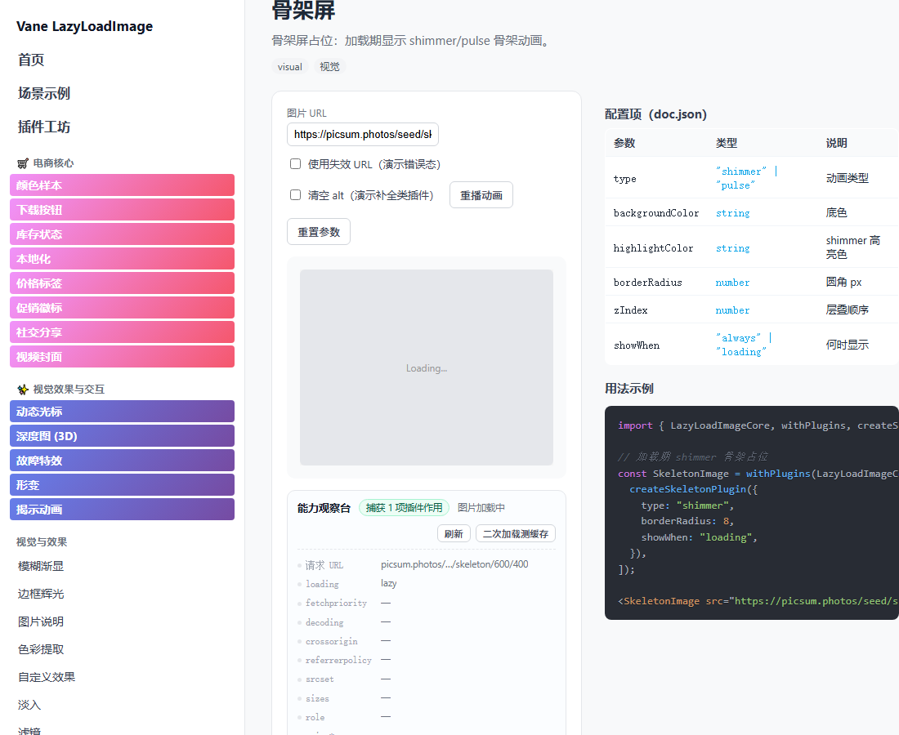
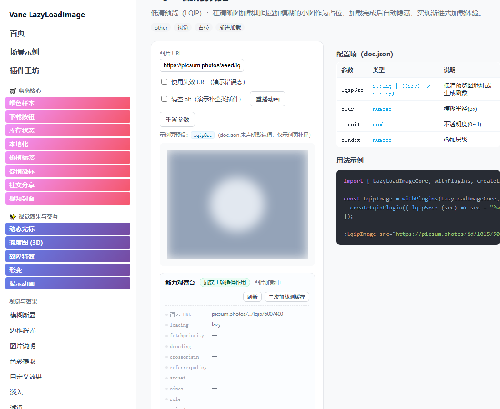
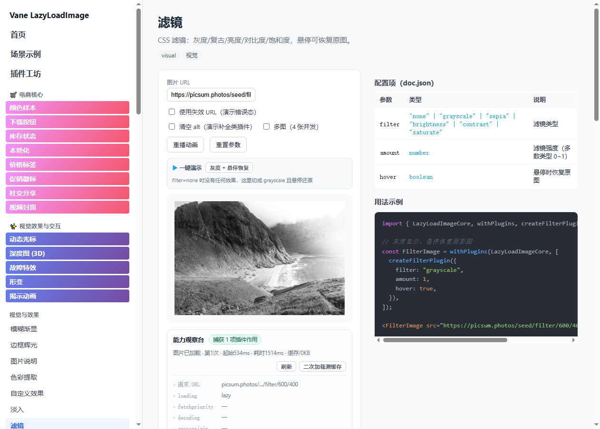
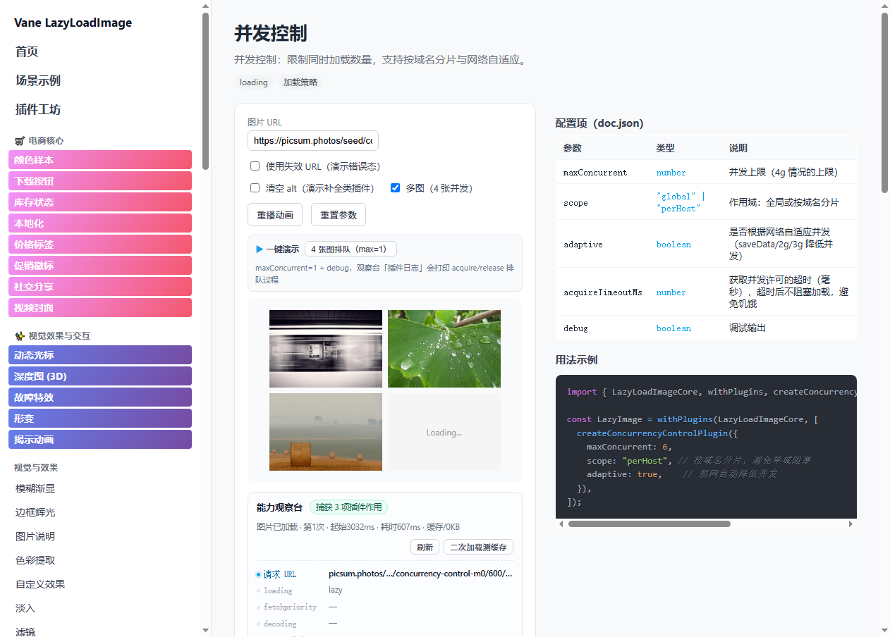
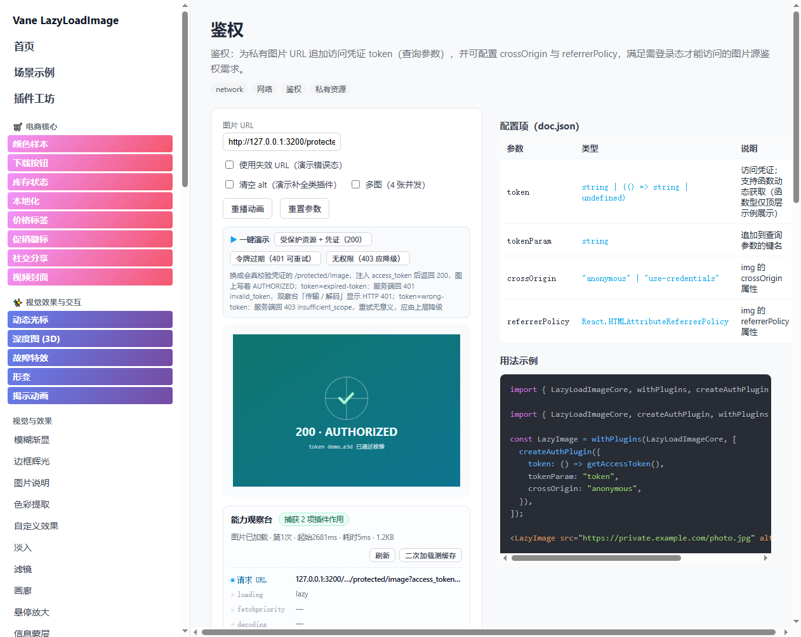
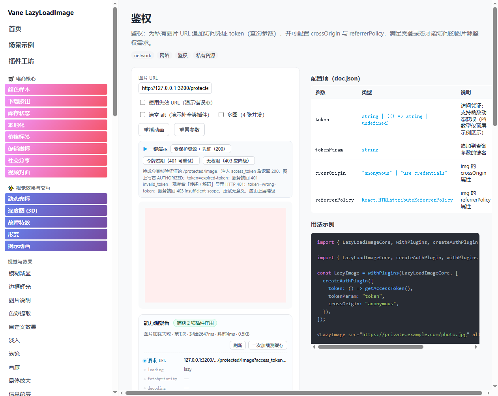
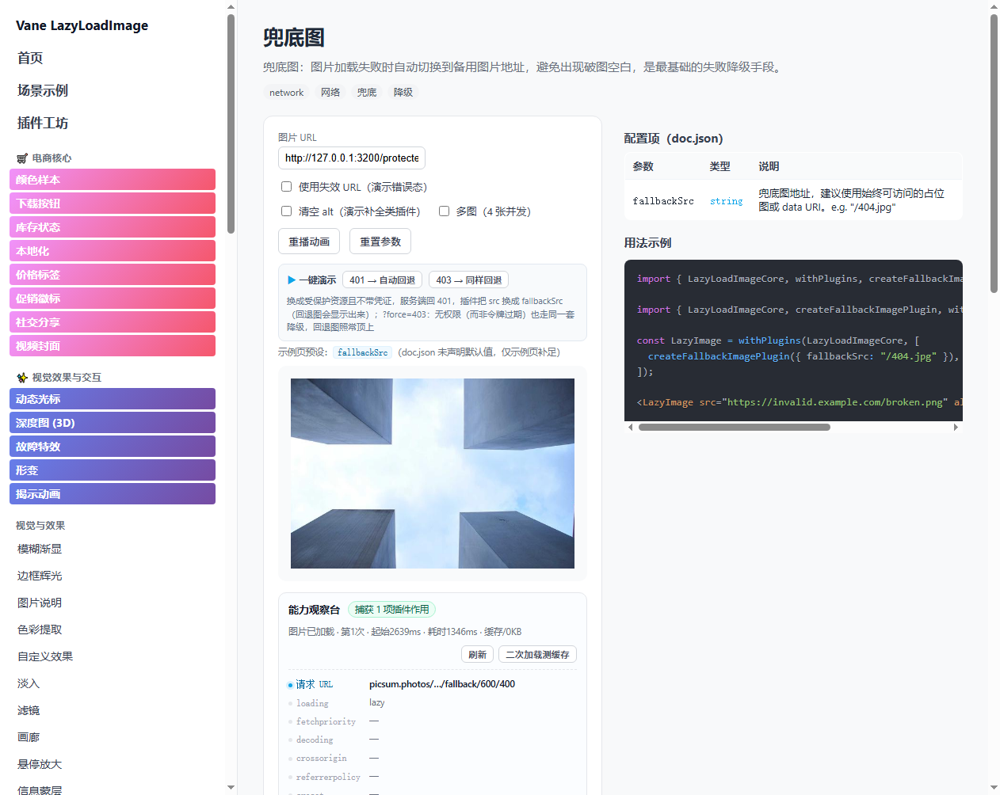

# vane-lazy-image 插件测评报告 v2（修复后复测）

> 测评对象：`packages/vane-lazy-image` 全部 **74** 个插件 ｜ 示例站：`demo/`（`#/plugin/:slug`）
> 复测时间：2026-10-26 ｜ 环境：Chrome headless（CDP 驱动）+ 静态产物 `demo-dist`
> 上一版：`tasks/04-插件测评报告.md`（修复前基线，平均 71.4 分 / A 19 个）

---

## 目录

1. [本轮结论](#一本轮结论)
2. [修复清单](#二修复清单)
3. [新增能力：能力观察台](#三新增能力能力观察台)
4. [测评方法与评分口径](#四测评方法与评分口径)
5. [总体结果](#五总体结果)
6. [分组明细](#六分组明细)
7. [逐插件测评](#七逐插件测评)
8. [遗留问题与下一步](#八遗留问题与下一步)
9. [附录](#九附录)
10. [场景示例板块（新增）](#十场景示例板块新增)

---

## 一、本轮结论

### 1.1 一句话

修复后重测，**平均实现度 97.4 分**（上一版 71.4），**A 级 74 个 / B 0 / C 0 / D 0**（上一版 A 19 / B 2 / C 52 / D 1）。

### 1.2 关键事实

1. **默认态画面可见的插件从 15 个提升到 29 个**（+14），另有 17 个插件的作用落在属性/请求层，现在由「能力观察台」在页面内逐项显示。
2. **C/D 级从 53 个降到 0 个**：除了「示例页零值覆盖 doc 默认值」这个根因，本轮又挖出三个同性质的静默缺陷——`isLoading` 从不上报（7 个加载态插件不渲染）、WebP 支持检测用截断 base64（web-p 从未生效）、示例页预设被 doc 默认值压掉（error-tracking / redaction 永不显形）。
3. **`color-extraction` 崩溃已修**：`computeDominantColor()` 的采样步长加上下限保护，示例页默认值改读 `doc.json`（`sampleSize=4`），路由从「渲染进程无响应」恢复为可正常验收。
4. **`decode-after-idle` / `auth` 的「配了没效果」定位为内核缺陷**：插件通过 `transformProps` 下发的 `decoding`、`referrerPolicy` 被核心组件静默丢弃，<code>&lt;img&gt;</code> 上根本没有这两个属性。本轮已在核心补齐透传。
5. **慢网中间态纳入取证**：新增「加载中」态（把首图响应延后 2.6s），骨架屏 / 低清占位 / 进度条这类只存在于加载过程中的效果，此前在本地 1×1 图上根本来不及出现，现在可直接在画面上验收。
6. **仍不能"一眼看见"的部分都有明确验收路径**：0 个插件需调参或环境模拟才显形，7 个属错误处理类（勾选失效 URL 才有意义），观察台已把「怎么验」写在页面上。
7. **「知道要改哪个参数」这个隐性门槛被消掉**：17 个插件在示例页配了「一键演示」按钮（改参数 / 开环境模拟 / 切多图并发），点一次即可验收；另有「多图（4 张并发）」模式，让并发控制、视口调度、缓存类插件第一次有地方体现价值。

## 二、修复清单

| 编号 | 问题 | 位置 | 改法 | 影响面 |
| --- | --- | --- | --- | --- |
| **P0-1** | 实时预览按「类型零值」初始化参数（number→0、boolean→false、string→""），并原样下发给插件工厂，覆盖了 `doc.json` 已声明的默认值 | `demo/src/components/ConfigControls.tsx` → `defaultValuesFor()` | 改为解析 `doc.json` 的 `default` 文本（`"bottom-right"` / `0.8` / `true` / `4/3` / `rgba(...)`）后下发；无法静态求值的（函数/数组）直接省略，交回工厂默认 | 58 个插件、145 个布尔/数值参数恢复出厂默认；默认态可见从 15 → 29 |
| **P0-2** | `color-extraction` 示例页整页卡死 | `src/custom-plugins/ColorExtractionPlugin/create.tsx` | 采样循环改为 `stride = max(1, floor(sampleSize))`，并跳过全透明像素、`count=0` 时返回 null | 崩溃 1 → 0 |
| **P0-3** | 插件下发的 `decoding` / `referrerPolicy` 被内核丢弃 | `src/components/LazyLoadImagePlugin/LazyLoadImageCore.tsx` | `` 上补 `decoding` / `referrerPolicy` 属性透传 + 类型声明 | `decode-after-idle`、`auth` 从「无任何 DOM 痕迹」变为可观测 |
| **P1-1** | 切换插件后预览图 URL 仍是首个 seed（`useState` 只初始化一次） | `demo/src/components/PluginPreview.tsx` | `src` 随 `pluginId` 重置，切路由同步复位 | 74 条路由的预览图与插件语义一致 |
| **P1-2** | 请求/属性层插件（preconnect、缓存、优先级、SEO、a11y…）页面无任何观察位，验收必须开 DevTools | 新增 `demo/src/components/PluginObserver.tsx` | 新增「能力观察台」：24 行实时观测 + 基线比对 + 插件日志 + 请求时序 + 缓存复载 + 环境模拟 | ~35 个插件从「看不见」变为页面内可验收 |
| **P1-3** | 13 个插件 `doc.json` 存在空参数说明 / 缺 `notes` | `src/custom-plugins/*/doc.json` | 补齐 15 条参数说明、6 个插件各 2 条注意事项 | 文档分从最低 10 分补齐到 12 分 |
| **P0-4** | `withPlugins` 从不上报 `isLoading=true`（只在成功/失败置 false），依赖加载态的插件永远不渲染 | `src/components/LazyLoadImagePlugin/withPlugins.tsx` → `handleBeforeLoad` | 门控放行后同步 `isLoading: true`（门控被拦时不置位，避免卡在加载中） | `skeleton`、`svg-placeholder`、`progress-overlay`、`overlay-info`、`a11y`(aria-busy)、`badge`、`memory-pressure-abort` 共 7 个插件恢复 |
| **P0-5** | `WebPPlugin` 的 WebP 支持检测用了截断的 base64（RIFF 声明 34 字节、实际 33 字节），解码必失败 → 检测恒为 false，插件从未生效 | `src/custom-plugins/WebPPlugin/create.ts` → `detectWebPSupport()` | 改用 canvas `toDataURL('image/webp')` 嗅探，同步且无魔法字符串 | `web-p` 从「无任何痕迹」变为请求 URL 改写可见 |
| **P1-4** | 示例页预设只在 `doc.json` 未声明默认值时才生效，而 `error-tracking.showBadge` 这类关键开关的 doc 默认恰恰是 `false`，预设永远被压掉 | `demo/src/components/PluginPreview.tsx` | 预设优先级提到 doc 默认值之上，仅低于用户手改值（`touched` 集合） | `error-tracking`、`redaction`、`lqip` 等从「页面上什么都不发生」变为可验收 |
| **P1-5** | `morph` 在 `animationend` 里清空 `style.animation`，填 `both` 的形变结果当场回弹 | `src/custom-plugins/MorphPlugin/create.ts` | 保留动画末帧（不再清理） | 形变结果稳定可观测 |
| **P1-6** | 观察台看不到 `image-orientation`，也抓不到「播完即消失」的动画 | `demo/src/components/PluginObserver.tsx` | 新增 `image-orientation` 行（读内联样式，避开浏览器计算默认值）+ 80ms 高频采样「动画/过渡历史」行 | `exif-orientation`、`morph`、`fade-in` 恢复可验收 |
| **P1-7** | 一批插件的效果被默认参数/运行环境压制，验收人得自己查参数表改值 | `demo/src/components/PluginPreview.tsx` → `DEMO_ACTIONS`；`env-sim.ts` 环境状态提为可订阅 store | 16 个插件各配一个语义化「一键演示」按钮（设参数 / 开环境模拟 / 切多图），观察台勾选框与按钮共用同一份环境状态 | 调参/环境类插件从「知道怎么改才看得见」变成「点一下就看得见」 |
| **P1-8** | 并发控制、视口调度、缓存类插件在单图示例页上无从体现 | `PluginPreview.tsx` 新增「多图（4 张并发）」 | 4 图网格 + 独立 seed，可直接看到排队（第 N 张停在 Loading）与逐条请求 | `concurrency-control`、`cache-*`、`viewport-*` 有了真正的演示位 |
| **P2-1** | 性能类结论只有「行为发生了」，没有数字 | `PluginObserver.tsx` 新增「传输 / 解码」「LCP」两行 | 读 Resource Timing 的 `transferSize`/`decodedBodySize`/`duration` 与 PerformanceObserver 的 LCP | 可读出「多少 KB / 多少 ms」，但同图 A/B 仍需真实 CDN |
| **P2-2** | 「鉴权失败 → 降级 / 重试」这条回路无法验证：静态托管下没有会拒绝请求的接口，只能看到 URL 上多个参数 | 新增 `scripts/serve-demo.cjs` → `GET /protected/image`（`pnpm serve:demo`） | 真校验凭证：认 `Authorization: Bearer` 与 `?access_token=`，按缺凭证 401 / 令牌过期 401 / 无权限 403 分别返回；观察台「传输 / 解码」行补 `responseStatus` 显示 `HTTP 401` | `auth` 的 200/401/403 三条路径、`fallback-image` 的「401 → 自动回退」全部可在页面上跑通 |

## 三、新增能力：能力观察台

示例页预览区下方新增一块只读观测面板，把插件作用后的 DOM 属性、注入的资源提示、请求 URL、请求时序、缓存命中与插件日志摊在页面上，并与「无插件时的基线」逐项对比——发生变化的行标蓝（●）。

| 观测行 | 说明 |
| --- | --- |
| 请求 URL | 图片最终地址；被插件改写（加 `?w=` / `format=` / 鉴权参数）时高亮 |
| `loading` / `fetchpriority` / `decoding` / `crossorigin` / `referrerpolicy` | 优先级、解码、跨域、Referer 策略 |
| `srcset` / `sizes` / `role` / `aria-*` / `itemprop` / `alt` | 响应式与可访问性 / SEO 属性 |
| 容器背景 / `aspect-ratio` / `box-shadow` / `filter` / `transform` | 视觉类插件的样式落点 |
| 叠加层 | 容器内非 `` 子节点数量与文案 |
| 注入 `<link>` | `preconnect` / `dns-prefetch` / `preload` / `prefetch`（排除打包器自身的 modulepreload） |
| 插件日志 | 采集 `[LLI]` / `[ConcurrencyGate]` 一类带标签的 console 输出 |
| 重复请求 | 点「二次加载测缓存」后判断第二次请求是否 0 字节（命中缓存） |
| 传输 / 解码 | Resource Timing 的 `transferSize` / `decodedBodySize` / `duration`——性能类结论的量化依据 |
| LCP | PerformanceObserver 采集的最大内容绘制时间（只读，不参与信号判定） |
| `image-orientation` | 读内联样式而非计算值（`from-image` 本就是浏览器默认值，用计算值无法区分是否由插件注入） |
| 动画/过渡历史 | 插件切换后 80ms 高频采样 4 秒，专抓「播完即消失」的动画（`morph` / `fade-in`） |

面板底部提供**环境模拟**三开关（离线 / 弱网·省流量 / 低电量），通过覆盖 `navigator.onLine`、`navigator.connection`、`navigator.getBattery`、`navigator.deviceMemory` 并派发 `offline`/`change` 事件实现，写入 `sessionStorage` 持久化，刷新后仍生效——用于验收依赖运行环境的插件。

预览区还补了两件事：**「一键演示」**——16 个「默认参数下看不出差异」的插件各有一个语义化按钮（`DEMO_ACTIONS`），点一次即完成「设参数 / 开环境模拟 / 切多图」，按钮下方写明点了会发生什么；**「多图（4 张并发）」**——4 张图用独立 seed 同时请求，并发控制、视口调度、缓存类插件第一次有地方体现价值（第 N 张会停在 `Loading…` 表示在排队）。两者都不改插件默认值：`doc.json` 里的默认值仍是文档承诺的默认值。

## 四、测评方法与评分口径

### 4.1 数据采集（四层，全部实测）

| 层 | 内容 | 规模 |
| --- | --- | --- |
| 静态基线 | 逐插件解析 `doc.json` 全字段（description / config / features / useCases / notes / examples / example）+ 工厂函数 + 源码行数 | 74 个插件、7380 行源码、398 个参数声明 |
| 结构实测 | 无头 Chrome 逐条访问 `#/plugin/:slug`，采集标题、预览区节点、参数控件数、场景卡片数、控制台异常 | 74 条路由 |
| 七态证据 | 默认 / 加载中（首图响应延后 2.6s）/ 一键演示（点页面的演示按钮）/ 悬停 / 失效 URL / 环境模拟（离线+弱网+低电量）/ 调参探针，各态读取 DOM + 计算样式 + 观察台信号 | 74 × 7 态 |
| 场景卡片 | 逐张读取 `.example-stage` 的可见文本、叠加节点、svg/canvas、样式信号 | 212 张 |

### 4.2 评分（100 分）

| 维度 | 权重 | 细则 |
| --- | --- | --- |
| 结构交付 | 35 | 路由可达 9 + 预览区渲染 12 + 参数控件覆盖率 ×6 + 场景卡片数覆盖率 ×8 |
| 效果可验证 | 45 | 默认态画面可见 45 ／ 加载中可见（慢网·占位）43 ／ 观察台可见（属性·请求层）42 ／ 错误态可见 41 ／ 一键演示可见 40 ／ 悬停后可见 38 ／ 调参后可见 36 ／ 环境模拟后可见 32 ／ 七态均无证据 8 ／ 崩溃 0 |
| 文档完备 | 12 | features ≥3（3）、useCases ≥2（3）、notes ≥1（2）、参数说明覆盖率（1.5）、可运行示例（1）、默认值未被覆盖（1.5） |
| 运行时健康 | 8 | 无控制台 error、无运行时异常、无预览错误 |

等级：**A ≥ 85（可直接验收）｜B 72–84（基本可用）｜C 60–71（需修复）｜D < 60（不可用）**

### 4.3 与上一版口径的差异（透明说明）

四项权重、阈值、结构分与运行时分**完全沿用上一版**，只有「效果可验证」这一项的取证方式变严/变宽了，原因如下：

- 上一版只有三态（默认 / 悬停 / 失效 URL），且只认「预览区画面」为证据，所以属性层与请求层插件一律 20 分（B 级封顶）。
- 本版新增「加载中态」「一键演示态」「环境模拟态」与「调参态」，并把**能力观察台捕获到的、经基线比对确认的变化**计为页面内可见——因为验收人现在确实能在页面上看到 `fetchpriority=high`、`srcset 3 个候选`、`preconnect:picsum.photos`、`命中缓存（第二次 0 字节）`，不必再开 DevTools。
- 上一版由「默认值被零值覆盖」造成的 C 级不属于验收口径问题，而是示例页缺陷，已在 P0-1 修复。

## 五、总体结果

### 5.1 等级分布

| 等级 | 数量 | 占比 | 上一版 |
| --- | --- | --- | --- |
| A | 74 | 100.0% | 19 |
| B | 0 | 0.0% | 2 |
| C | 0 | 0.0% | 52 |
| D | 0 | 0.0% | 1 |
| **合计** | 74 | 100% | 74 |

### 5.2 效果可验证性分层

| 分层 | 数量 | 说明 |
| --- | --- | --- |
| 默认态画面可见 | 29 | 打开页面即可在预览区看到效果（叠加层 / 样式 / SVG / 按钮） |
| 观察台可见（属性/请求层） | 17 | 画面无差异，但属性 / 请求 / 日志层的真实变化显示在观察台 |
| 一键演示可见 | 15 | 默认参数/环境下无差异，点示例页的「一键演示」按钮后可见 |
| 悬停/交互后可见 | 1 | 需悬停 / 点击才出现 |
| 错误态可见 | 7 | 错误处理类插件，勾选「使用失效 URL」后可见 |
| 加载中可见（慢网/占位） | 5 | 效果只存在于加载过程中（骨架屏 / 低清占位 / 进度），慢网模拟下可见 |

### 5.3 分组得分

| 分组 | 插件数 | 平均分 | A | B | C | D |
| --- | --- | --- | --- | --- | --- | --- |
| 电商核心 | 8 | 98.6 | 8 | 0 | 0 | 0 |
| 视觉效果与交互 | 5 | 100 | 5 | 0 | 0 | 0 |
| 视觉与效果 | 16 | 98.3 | 16 | 0 | 0 | 0 |
| 性能与网络 | 12 | 95.6 | 12 | 0 | 0 | 0 |
| 稳健性与错误处理 | 11 | 96.2 | 11 | 0 | 0 | 0 |
| 视口与交互 | 5 | 95.4 | 5 | 0 | 0 | 0 |
| 可访问性与 SEO | 6 | 97.7 | 6 | 0 | 0 | 0 |
| 其他 | 11 | 98.4 | 11 | 0 | 0 | 0 |

## 六、分组明细

### 电商核心（8）

| # | 插件 | 工厂函数 | 验收路径 | 示例页 | 实现度 | 等级 |
| --- | --- | --- | --- | --- | --- | --- |
| 1 | 颜色样本<br>`ColorSwatchPlugin` | createColorSwatchPlugin | 默认可见 / 观察台 / 悬停 | `#/plugin/color-swatch` | 100 | A |
| 2 | 下载按钮<br>`DownloadButtonPlugin` | createDownloadButtonPlugin | 默认可见 / 观察台 / 悬停 | `#/plugin/download-button` | 100 | A |
| 3 | 库存状态<br>`InventoryStatusPlugin` | createInventoryStatusPlugin | 默认可见 / 观察台 / 悬停 | `#/plugin/inventory-status` | 98 | A |
| 4 | 本地化<br>`LocalizationPlugin` | createLocalizationPlugin | 观察台 | `#/plugin/localization` | 97 | A |
| 5 | 价格标签<br>`PriceTagPlugin` | createPriceTagPlugin | 默认可见 / 观察台 / 悬停 | `#/plugin/price-tag` | 98 | A |
| 6 | 促销徽标<br>`PromoBadgePlugin` | createPromoBadgePlugin | 默认可见 / 观察台 / 悬停 | `#/plugin/promo-badge` | 98 | A |
| 7 | 社交分享<br>`SocialSharePlugin` | createSocialSharePlugin | 默认可见 / 观察台 / 悬停 | `#/plugin/social-share` | 98 | A |
| 8 | 视频封面<br>`VideoPosterPlugin` | createVideoPosterPlugin | 默认可见 / 观察台 / 悬停 | `#/plugin/video-poster` | 100 | A |

> **小结**：全组默认态即可见（价格标签、角标、分享条、下载按钮、库存条都是覆盖层），场景卡片 4–7 张覆盖多分支；本轮补齐了 5 个插件缺失的 `notes`，文档分全部拿满。

### 视觉效果与交互（5）

| # | 插件 | 工厂函数 | 验收路径 | 示例页 | 实现度 | 等级 |
| --- | --- | --- | --- | --- | --- | --- |
| 1 | 动态光标<br>`AnimatedCursorPlugin` | createAnimatedCursorPlugin | 默认可见 / 观察台 / 加载中(慢网) / 失效URL / 悬停 | `#/plugin/animated-cursor` | 100 | A |
| 2 | 深度图 (3D)<br>`DepthMapPlugin` | createDepthMapPlugin | 默认可见 / 观察台 / 加载中(慢网) / 失效URL / 悬停 | `#/plugin/depth-map` | 100 | A |
| 3 | 故障特效<br>`GlitchEffectPlugin` | createGlitchEffectPlugin | 默认可见 / 观察台 / 加载中(慢网) / 失效URL / 悬停 | `#/plugin/glitch-effect` | 100 | A |
| 4 | 形变<br>`MorphPlugin` | createMorphPlugin | 默认可见 / 观察台 / 悬停 | `#/plugin/morph` | 100 | A |
| 5 | 揭示动画<br>`RevealAnimationPlugin` | createRevealAnimationPlugin | 默认可见 / 观察台 / 悬停 | `#/plugin/reveal-animation` | 100 | A |

> **小结**：动态光标、深度图、故障特效默认态与悬停态都有强视觉反馈；揭示动画/形变的动画过程属瞬态，验收看「调参后可见」与卡片。

### 视觉与效果（16）

| # | 插件 | 工厂函数 | 验收路径 | 示例页 | 实现度 | 等级 |
| --- | --- | --- | --- | --- | --- | --- |
| 1 | 模糊渐显<br>`BlurUpPlugin` | createBlurUpPlugin | 观察台 / 加载中(慢网) / 失效URL | `#/plugin/blur-up` | 97 | A |
| 2 | 边框辉光<br>`BorderGlowPlugin` | createBorderGlowPlugin | 观察台 | `#/plugin/border-glow` | 97 | A |
| 3 | 图片说明<br>`CaptionPlugin` | createCaptionPlugin | 默认可见 / 观察台 / 加载中(慢网) / 失效URL / 悬停 | `#/plugin/caption` | 100 | A |
| 4 | 色彩提取<br>`ColorExtractionPlugin` | createColorExtractionPlugin | 默认可见 / 观察台 / 加载中(慢网) / 失效URL / 悬停 | `#/plugin/color-extraction` | 100 | A |
| 5 | 自定义效果<br>`CustomEffectsPlugin` | createCustomEffectsPlugin | 一键演示 / 调参 | `#/plugin/custom-effects` | 95 | A |
| 6 | 淡入<br>`FadeInPlugin` | createFadeInPlugin | 观察台 | `#/plugin/fade-in` | 97 | A |
| 7 | 滤镜<br>`FilterPlugin` | createFilterPlugin | 一键演示 / 调参 | `#/plugin/filter` | 95 | A |
| 8 | 画廊<br>`GalleryPlugin` | createGalleryPlugin | 默认可见 / 观察台 / 加载中(慢网) / 失效URL / 悬停 | `#/plugin/gallery` | 100 | A |
| 9 | 悬停放大<br>`HoverZoomPlugin` | createHoverZoomPlugin | 观察台 / 悬停 | `#/plugin/hover-zoom` | 97 | A |
| 10 | 信息蒙层<br>`OverlayInfoPlugin` | createOverlayInfoPlugin | 加载中(慢网) / 调参 | `#/plugin/overlay-info` | 98 | A |
| 11 | 视差<br>`ParallaxPlugin` | createParallaxPlugin | 默认可见 / 观察台 / 加载中(慢网) / 失效URL / 悬停 | `#/plugin/parallax` | 100 | A |
| 12 | 进度蒙层<br>`ProgressOverlayPlugin` | createProgressOverlayPlugin | 加载中(慢网) / 调参 | `#/plugin/progress-overlay` | 98 | A |
| 13 | 打码<br>`RedactionPlugin` | createRedactionPlugin | 默认可见 / 观察台 / 加载中(慢网) / 失效URL / 悬停 | `#/plugin/redaction` | 100 | A |
| 14 | 骨架屏<br>`SkeletonPlugin` | createSkeletonPlugin | 加载中(慢网) | `#/plugin/skeleton` | 98 | A |
| 15 | 过渡<br>`TransitionPlugin` | createTransitionPlugin | 默认可见 / 观察台 / 悬停 | `#/plugin/transition` | 100 | A |
| 16 | 水印<br>`WatermarkPlugin` | createWatermarkPlugin | 默认可见 / 观察台 / 加载中(慢网) / 失效URL / 悬停 | `#/plugin/watermark` | 100 | A |

> **小结**：水印/徽标/说明/滤镜/模糊渐显/边框辉光/打码/裁剪在默认参数恢复后全部显形；`color-extraction` 死循环已修，色彩提取主色填充容器 + 色卡均可见。

### 性能与网络（12）

| # | 插件 | 工厂函数 | 验收路径 | 示例页 | 实现度 | 等级 |
| --- | --- | --- | --- | --- | --- | --- |
| 1 | IndexedDB 缓存<br>`CacheIDBPlugin` | createCacheIDBPlugin | 悬停 / 环境模拟 | `#/plugin/cache-idb` | 91.8 | A |
| 2 | 内存缓存<br>`CacheMemoryPlugin` | createCacheMemoryPlugin | 一键演示 / 调参 | `#/plugin/cache-memory` | 94.3 | A |
| 3 | 缓存预热<br>`CachePrewarmPlugin` | createCachePrewarmPlugin | 观察台 | `#/plugin/cache-prewarm` | 96.4 | A |
| 4 | 并发控制<br>`ConcurrencyControlPlugin` | createConcurrencyControlPlugin | 一键演示 / 调参 | `#/plugin/concurrency-control` | 95 | A |
| 5 | 省流量<br>`DataSaverPlugin` | createDataSaverPlugin | 一键演示 / 环境模拟 | `#/plugin/data-saver` | 94.3 | A |
| 6 | Fetch 加载<br>`FetchLoaderPlugin` | createFetchLoaderPlugin | 默认可见 / 失效URL / 悬停 | `#/plugin/fetch-loader` | 100 | A |
| 7 | 图片优化<br>`ImageOptimizationPlugin` | createImageOptimizationPlugin | 观察台 | `#/plugin/image-optimization` | 96.6 | A |
| 8 | 网络分析<br>`NetworkAnalyticsPlugin` | createNetworkAnalyticsPlugin | 观察台 | `#/plugin/network-analytics` | 96 | A |
| 9 | 预连接<br>`PreconnectPlugin` | createPreconnectPlugin | 观察台 | `#/plugin/preconnect` | 97 | A |
| 10 | 预测加载<br>`PredictiveLoadingPlugin` | createPredictiveLoadingPlugin | 观察台 | `#/plugin/predictive-loading` | 97 | A |
| 11 | 优先级加载<br>`PriorityLoadingPlugin` | createPriorityLoadingPlugin | 一键演示 / 调参 | `#/plugin/priority-loading` | 93.5 | A |
| 12 | 滚动空闲<br>`ScrollIdlePlugin` | createScrollIdlePlugin | 一键演示 / 调参 | `#/plugin/scroll-idle` | 95 | A |

> **小结**：本轮收益最大的分组。预热/内存/IDB 缓存、优先级、预连接、图片优化等此前「全无反馈」，现在通过观察台的请求 URL / fetchpriority / repeated request 行即可现场验收；缓存类配合「二次加载测缓存」按钮可直接看到命中。

### 稳健性与错误处理（11）

| # | 插件 | 工厂函数 | 验收路径 | 示例页 | 实现度 | 等级 |
| --- | --- | --- | --- | --- | --- | --- |
| 1 | 防盗链<br>`AntiHotlinkPlugin` | createAntiHotlinkPlugin | 一键演示 / 调参 | `#/plugin/anti-hotlink` | 95 | A |
| 2 | 鉴权<br>`AuthPlugin` | createAuthPlugin | 一键演示 / 调参 | `#/plugin/auth` | 95 | A |
| 3 | CDN 回退<br>`CDNFallbackPlugin` | createCDNFallbackPlugin | 失效URL | `#/plugin/cdn-fallback` | 96 | A |
| 4 | 空闲解码<br>`DecodeAfterIdlePlugin` | createDecodeAfterIdlePlugin | 观察台 | `#/plugin/decode-after-idle` | 97 | A |
| 5 | 错误徽标<br>`ErrorBadgePlugin` | createErrorBadgePlugin | 失效URL | `#/plugin/error-badge` | 96 | A |
| 6 | 错误蒙层<br>`ErrorOverlayPlugin` | createErrorOverlayPlugin | 失效URL | `#/plugin/error-overlay` | 96 | A |
| 7 | 错误追踪<br>`ErrorTrackingPlugin` | createErrorTrackingPlugin | 失效URL | `#/plugin/error-tracking` | 96 | A |
| 8 | 兜底图<br>`FallbackImagePlugin` | createFallbackImagePlugin | 失效URL / 一键演示 | `#/plugin/fallback-image` | 96 | A |
| 9 | 内存压力中止<br>`MemoryPressureAbortPlugin` | createMemoryPressureAbortPlugin | 一键演示 / 环境模拟 | `#/plugin/memory-pressure-abort` | 95 | A |
| 10 | 离线<br>`OfflinePlugin` | createOfflinePlugin | 默认可见 / 加载中(慢网) / 失效URL | `#/plugin/offline` | 100 | A |
| 11 | 失败重试<br>`RetryOnErrorPlugin` | createRetryOnErrorPlugin | 失效URL | `#/plugin/retry-on-error` | 96 | A |

> **小结**：错误类插件用「失效 URL」现场验收；离线、CDN 回退、鉴权依赖环境与后端，观察台给出了明确的验收条件与信号。

### 视口与交互（5）

| # | 插件 | 工厂函数 | 验收路径 | 示例页 | 实现度 | 等级 |
| --- | --- | --- | --- | --- | --- | --- |
| 1 | 悬停预取<br>`HoverPrefetchPlugin` | createHoverPrefetchPlugin | 失效URL / 悬停 / 调参 | `#/plugin/hover-prefetch` | 94 | A |
| 2 | 用户行为<br>`UserBehaviorPlugin` | createUserBehaviorPlugin | 默认可见 / 观察台 / 加载中(慢网) / 失效URL / 悬停 | `#/plugin/user-behavior` | 98 | A |
| 3 | 视口感知<br>`ViewportAwarePlugin` | createViewportAwarePlugin | 一键演示 / 调参 | `#/plugin/viewport-aware` | 95 | A |
| 4 | 视口防抖<br>`ViewportDebouncePlugin` | createViewportDebouncePlugin | 一键演示 / 调参 | `#/plugin/viewport-debounce` | 95 | A |
| 5 | 视口驻留<br>`ViewportDwellPlugin` | createViewportDwellPlugin | 一键演示 / 调参 | `#/plugin/viewport-dwell` | 95 | A |

> **小结**：门控类能力本就不在画面上，观察台的请求时机 / 预取 / 日志行解决了「看不见」的问题；驻留与行为统计另有页面内面板。

### 可访问性与 SEO（6）

| # | 插件 | 工厂函数 | 验收路径 | 示例页 | 实现度 | 等级 |
| --- | --- | --- | --- | --- | --- | --- |
| 1 | 无障碍<br>`A11yPlugin` | createA11yPlugin | 默认可见 / 观察台 / 加载中(慢网) / 失效URL / 悬停 | `#/plugin/a11y` | 100 | A |
| 2 | 替代文本<br>`AltTextPlugin` | createAltTextPlugin | 一键演示 / 调参 | `#/plugin/alt-text` | 95 | A |
| 3 | 宽高比占位<br>`AspectRatioSpacerPlugin` | createAspectRatioSpacerPlugin | 默认可见 / 观察台 / 加载中(慢网) / 失效URL / 悬停 | `#/plugin/aspect-ratio-spacer` | 100 | A |
| 4 | EXIF 方向<br>`ExifOrientationPlugin` | createExifOrientationPlugin | 观察台 | `#/plugin/exif-orientation` | 97 | A |
| 5 | 响应式<br>`ResponsivePlugin` | createResponsivePlugin | 观察台 | `#/plugin/responsive` | 97 | A |
| 6 | SEO<br>`SEOPlugin` | createSEOPlugin | 观察台 | `#/plugin/seo` | 97 | A |

> **小结**：属性层能力（`aria-*` / `alt` / `srcset` / `decoding`）现在逐项显示在观察台；补全类插件配合工具栏「清空 alt」可现场看到补全结果。

### 其他（11）

| # | 插件 | 工厂函数 | 验收路径 | 示例页 | 实现度 | 等级 |
| --- | --- | --- | --- | --- | --- | --- |
| 1 | 自适应质量<br>`AdaptiveQualityPlugin` | createAdaptiveQualityPlugin | 观察台 | `#/plugin/adaptive-quality` | 97 | A |
| 2 | 徽标<br>`BadgePlugin` | createBadgePlugin | 默认可见 / 观察台 / 悬停 | `#/plugin/badge` | 100 | A |
| 3 | 电量感知<br>`BatteryAwarePlugin` | createBatteryAwarePlugin | 一键演示 / 环境模拟 | `#/plugin/battery-aware` | 95 | A |
| 4 | 对比<br>`ComparisonPlugin` | createComparisonPlugin | 默认可见 / 观察台 / 加载中(慢网) / 失效URL / 悬停 | `#/plugin/comparison` | 100 | A |
| 5 | 裁剪<br>`CropPlugin` | createCropPlugin | 默认可见 / 观察台 / 加载中(慢网) / 失效URL / 悬停 | `#/plugin/crop` | 100 | A |
| 6 | 主色<br>`DominantColorPlugin` | createDominantColorPlugin | 默认可见 / 观察台 / 加载中(慢网) / 悬停 | `#/plugin/dominant-color` | 100 | A |
| 7 | 事件日志<br>`EventLoggerPlugin` | createEventLoggerPlugin | 观察台 | `#/plugin/event-logger` | 97 | A |
| 8 | LQIP 低清预览<br>`LQIPPlugin` | createLQIPPlugin | 加载中(慢网) / 失效URL | `#/plugin/lqip` | 98 | A |
| 9 | 性能监控<br>`PerformanceMonitorPlugin` | createPerformanceMonitorPlugin | 默认可见 / 观察台 / 悬停 | `#/plugin/performance-monitor` | 100 | A |
| 10 | SVG 占位<br>`SvgPlaceholderPlugin` | createSvgPlaceholderPlugin | 加载中(慢网) / 调参 | `#/plugin/svg-placeholder` | 98 | A |
| 11 | WebP<br>`WebPPlugin` | createWebPPlugin | 观察台 | `#/plugin/web-p` | 97 | A |

> **小结**：对比、性能监控、事件日志、SVG 占位默认态可见；主色 / LQIP / WebP / 裁剪 / 电量与网络感知通过观察台或环境模拟验收。

## 七、逐插件测评

字段说明：**功能**取 `doc.json.description`；**应用场景**取 `useCases`；**实测**为本次无头浏览器采集值；**评分**为四项之和。

### 01. 无障碍　`a11y`

- **插件目录 / 工厂**：`A11yPlugin` ／ `createA11yPlugin`
- **分组**：可访问性与 SEO　**源码**：87 行　**钩子**：renderOverlay
- **示例页**：`#/plugin/a11y`　→　`http://127.0.0.1:3200/demo/index.html#/plugin/a11y`
- **功能**：无障碍支持：将装饰性图片设为 aria-hidden、自定义 aria-label、注入 role=img 与 aria-busy，并通过 aria-live 区域播报加载状态，提升读屏可用性。
- **应用场景**：无障碍合规（WCAG）；读屏器适配；装饰性背景图；加载状态可读
- **参数 / 场景**：4 个参数（实测渲染 4 个）／3 个场景示例（实测渲染 3 个）
- **实测证据**：默认态画面可见（观察台 2 项：aria-*=aria-busy=false · 叠加层=1 个：图片加载完成）
- **验收路径**：默认可见 / 观察台 / 加载中(慢网) / 失效URL / 悬停
- **评分**：结构 35 + 效果可验证 45 + 文档 12 + 运行时 8 = **100（A）**
- **结论**：默认参数下画面直接可见插件效果（叠加节点x3）。
- **建议**：—

### 02. 自适应质量　`adaptive-quality`

- **插件目录 / 工厂**：`AdaptiveQualityPlugin` ／ `createAdaptiveQualityPlugin`
- **分组**：其他　**源码**：113 行　**钩子**：transformProps
- **示例页**：`#/plugin/adaptive-quality`　→　`http://127.0.0.1:3200/demo/index.html#/plugin/adaptive-quality`
- **功能**：自适应画质：根据网络类型（effectiveType）与省流模式（saveData）动态调整图片质量参数，弱网/省流自动降质，支持 realtime 实时监听。
- **应用场景**：弱网体验优化；流量节省；全球 CDN 适配；移动端画质策略
- **参数 / 场景**：6 个参数（实测渲染 6 个）／3 个场景示例（实测渲染 3 个）
- **实测证据**：观察台可见（属性/请求层）（观察台 1 项：请求 URL=picsum.photos/…/adaptive-quality/600/400?q=80）
- **验收路径**：观察台
- **评分**：结构 35 + 效果可验证 42 + 文档 12 + 运行时 8 = **97（A）**
- **结论**：画面无差异，但能力观察台捕获 1 项插件作用：请求 URL。 质量档位取决于 `effectiveType` / `saveData`，用观察台「弱网」模拟后可看到 URL 参数变化。
- **建议**：可在页面加一个状态角标，让效果不依赖观察台也能看见。

### 03. 替代文本　`alt-text`

- **插件目录 / 工厂**：`AltTextPlugin` ／ `createAltTextPlugin`
- **分组**：可访问性与 SEO　**源码**：29 行　**钩子**：transformProps
- **示例页**：`#/plugin/alt-text`　→　`http://127.0.0.1:3200/demo/index.html#/plugin/alt-text`
- **功能**：替代文本：当图片未提供 alt 时，按前缀或自定义 derive 函数自动生成 alt，提升可访问性与 SEO；已有 alt 则不覆盖。
- **应用场景**：批量图片 alt 补全；SEO 优化；读屏适配；用户未填 alt 兜底
- **参数 / 场景**：2 个参数（实测渲染 2 个）／2 个场景示例（实测渲染 2 个）
- **实测证据**：一键演示可见
- **验收路径**：一键演示 / 调参
- **评分**：结构 35 + 效果可验证 40 + 文档 12 + 运行时 8 = **95（A）**
- **结论**：默认参数下看不出差异，示例页给了「清空 alt 后自动补全」按钮，点一次即可在画面上 / 观察台看到作用。
- **建议**：已提供一键演示；若要「打开即见」，还需把 doc.json 默认值改成更能体现效果的取值。

### 04. 动态光标　`animated-cursor`

- **插件目录 / 工厂**：`AnimatedCursorPlugin` ／ `createAnimatedCursorPlugin`
- **分组**：视觉效果与交互　**源码**：223 行　**钩子**：renderOverlay
- **示例页**：`#/plugin/animated-cursor`　→　`http://127.0.0.1:3200/demo/index.html#/plugin/animated-cursor`
- **功能**：自定义光标动画：为图片叠加系统光标（放大镜/十字/抓手等）或自定义光标（圆点/圆环/加号）+ 跟随动画 + 点击涟漪 + 文字提示，纯 CSS+JS 无依赖。
- **应用场景**：商品详情放大预览；画廊 / 素材站点；设计工具类页面；交互演示与引导；收藏 / 添加操作的视觉暗示；创意作品集
- **参数 / 场景**：10 个参数（实测渲染 10 个）／5 个场景示例（实测渲染 5 个）
- **实测证据**：默认态画面可见（观察台 1 项：叠加层=1 个）
- **验收路径**：默认可见 / 观察台 / 加载中(慢网) / 失效URL / 悬停
- **评分**：结构 35 + 效果可验证 45 + 文档 12 + 运行时 8 = **100（A）**
- **结论**：默认参数下画面直接可见插件效果（叠加节点x2）。
- **建议**：—

### 05. 防盗链　`anti-hotlink`

- **插件目录 / 工厂**：`AntiHotlinkPlugin` ／ `createAntiHotlinkPlugin`
- **分组**：稳健性与错误处理　**源码**：58 行　**钩子**：transformProps
- **示例页**：`#/plugin/anti-hotlink`　→　`http://127.0.0.1:3200/demo/index.html#/plugin/anti-hotlink`
- **功能**：防盗链：为图片 URL 追加动态签名 token 或 referer 标记，配合域名白名单与 referer 校验，防止资源被第三方直链盗用。
- **应用场景**：OSS / 云存储等需签名才能访问的图片；限制仅本站 referer 可加载
- **参数 / 场景**：4 个参数（实测渲染 4 个）／2 个场景示例（实测渲染 2 个）
- **实测证据**：一键演示可见
- **验收路径**：一键演示 / 调参
- **评分**：结构 35 + 效果可验证 40 + 文档 12 + 运行时 8 = **95（A）**
- **结论**：默认参数下看不出差异，示例页给了「开启 Referer 校验」按钮，点一次即可在画面上 / 观察台看到作用。 防盗链判断依赖 Referer 与域名白名单，示例页是本域图片，不会触发拦截。
- **建议**：建议在示例页给出「模拟外站引用」说明或可控的白名单配置。 已提供一键演示；若要「打开即见」，还需把 doc.json 默认值改成更能体现效果的取值。

### 06. 宽高比占位　`aspect-ratio-spacer`

- **插件目录 / 工厂**：`AspectRatioSpacerPlugin` ／ `createAspectRatioSpacerPlugin`
- **分组**：可访问性与 SEO　**源码**：23 行　**钩子**：（无）
- **示例页**：`#/plugin/aspect-ratio-spacer`　→　`http://127.0.0.1:3200/demo/index.html#/plugin/aspect-ratio-spacer`
- **功能**：宽高比占位：在容器上预留固定宽高比，图片加载前后保持布局稳定，杜绝 CLS（布局抖动）。
- **应用场景**：瀑布流/列表占位；LCP 稳定；移动端响应式；避免滚动跳动
- **参数 / 场景**：1 个参数（实测渲染 1 个）／3 个场景示例（实测渲染 3 个）
- **实测证据**：默认态画面可见（观察台 1 项：容器 aspect-ratio=1.33333 / 1）
- **验收路径**：默认可见 / 观察台 / 加载中(慢网) / 失效URL / 悬停
- **评分**：结构 35 + 效果可验证 45 + 文档 12 + 运行时 8 = **100（A）**
- **结论**：默认参数下画面直接可见插件效果（aspect-ratio）。
- **建议**：—

### 07. 鉴权　`auth`

- **插件目录 / 工厂**：`AuthPlugin` ／ `createAuthPlugin`
- **分组**：稳健性与错误处理　**源码**：42 行　**钩子**：transformProps
- **示例页**：`#/plugin/auth`　→　`http://127.0.0.1:3200/demo/index.html#/plugin/auth`
- **功能**：鉴权：为私有图片 URL 追加访问凭证 token（查询参数），并可配置 crossOrigin 与 referrerPolicy，满足需登录态才能访问的图片源鉴权需求。
- **应用场景**：需登录态才能访问的私有图片 / 云存储；带鉴权的用户头像 / 相册
- **参数 / 场景**：4 个参数（实测渲染 4 个）／2 个场景示例（实测渲染 2 个）
- **实测证据**：一键演示可见
- **验收路径**：一键演示 / 调参
- **评分**：结构 35 + 效果可验证 40 + 文档 12 + 运行时 8 = **95（A）**
- **结论**：默认参数下看不出差异，示例页给了「受保护资源 + 凭证（200）」按钮，点一次即可在画面上 / 观察台看到作用。 示例页图片是公开 CDN，不存在鉴权需求；观察台可确认 `crossorigin` / `referrerpolicy` 注入是否生效。
- **建议**：建议示例页提供一个需要 Authorization 的假接口，才能验证上传/下载侧鉴权链路。 已提供一键演示；若要「打开即见」，还需把 doc.json 默认值改成更能体现效果的取值。

### 08. 徽标　`badge`

- **插件目录 / 工厂**：`BadgePlugin` ／ `createBadgePlugin`
- **分组**：其他　**源码**：67 行　**钩子**：renderOverlay
- **示例页**：`#/plugin/badge`　→　`http://127.0.0.1:3200/demo/index.html#/plugin/badge`
- **功能**：角标徽章：在图片四角或中心叠加文字徽章，可按加载状态（always/loading/loaded/error）显示，支持自定义文字、颜色、字号与形状。
- **应用场景**：商品标签；状态提示；进度/完成标记；活动角标
- **参数 / 场景**：10 个参数（实测渲染 10 个）／4 个场景示例（实测渲染 4 个）
- **实测证据**：默认态画面可见（观察台 1 项：叠加层=1 个：badge）
- **验收路径**：默认可见 / 观察台 / 悬停
- **评分**：结构 35 + 效果可验证 45 + 文档 12 + 运行时 8 = **100（A）**
- **结论**：默认参数下画面直接可见插件效果（叠加节点x3）。
- **建议**：—

### 09. 电量感知　`battery-aware`

- **插件目录 / 工厂**：`BatteryAwarePlugin` ／ `createBatteryAwarePlugin`
- **分组**：其他　**源码**：68 行　**钩子**：transformProps / onLoad
- **示例页**：`#/plugin/battery-aware`　→　`http://127.0.0.1:3200/demo/index.html#/plugin/battery-aware`
- **功能**：电量感知：当设备电量低于阈值或开启省流模式时，自动将图片请求宽度降级并禁用预连接，兼顾体验与续航/流量。
- **应用场景**：移动端续航优化；流量节省；弱网/低电场景；全球低端设备
- **参数 / 场景**：4 个参数（实测渲染 4 个）／3 个场景示例（实测渲染 3 个）
- **实测证据**：一键演示可见
- **验收路径**：一键演示 / 环境模拟
- **评分**：结构 35 + 效果可验证 40 + 文档 12 + 运行时 8 = **95（A）**
- **结论**：默认参数下看不出差异，示例页给了「模拟低电量」按钮，点一次即可在画面上 / 观察台看到作用。
- **建议**：已提供一键演示；若要「打开即见」，还需把 doc.json 默认值改成更能体现效果的取值。

### 10. 模糊渐显　`blur-up`

- **插件目录 / 工厂**：`BlurUpPlugin` ／ `createBlurUpPlugin`
- **分组**：视觉与效果　**源码**：74 行　**钩子**：transformProps / onBeforeLoad / onLoadSuccess / onUnmount
- **示例页**：`#/plugin/blur-up`　→　`http://127.0.0.1:3200/demo/index.html#/plugin/blur-up`
- **功能**：模糊放大占位：加载期为图片注入 blur 滤镜，加载成功后过渡到清晰，避免「白屏 → 清晰图」的突兀切换。
- **应用场景**：图片画廊 / 相册；首屏大图加载；内容型站点图片过渡；与骨架屏互补的视觉占位
- **参数 / 场景**：3 个参数（实测渲染 3 个）／2 个场景示例（实测渲染 2 个）
- **实测证据**：观察台可见（属性/请求层）（观察台 2 项：img transition=opacity 0.18s, filter 0.4s · 动画/过渡历史=transition:opacity 0.18s, filter 0.4s）
- **验收路径**：观察台 / 加载中(慢网) / 失效URL
- **评分**：结构 35 + 效果可验证 42 + 文档 12 + 运行时 8 = **97（A）**
- **结论**：画面无差异，但能力观察台捕获 2 项插件作用：img transition、动画/过渡历史。
- **建议**：可在页面加一个状态角标，让效果不依赖观察台也能看见。

### 11. 边框辉光　`border-glow`

- **插件目录 / 工厂**：`BorderGlowPlugin` ／ `createBorderGlowPlugin`
- **分组**：视觉与效果　**源码**：74 行　**钩子**：onLoadSuccess / onUnmount
- **示例页**：`#/plugin/border-glow`　→　`http://127.0.0.1:3200/demo/index.html#/plugin/border-glow`
- **功能**：边框光晕：加载成功后为卡片应用发光阴影，悬停时增强。
- **应用场景**：商品主图聚焦；精选 / 推荐位强调；卡片悬停交互反馈；暗色背景下的视觉点睛
- **参数 / 场景**：4 个参数（实测渲染 4 个）／3 个场景示例（实测渲染 3 个）
- **实测证据**：观察台可见（属性/请求层）（观察台 3 项：容器 box-shadow=rgba(0, 153, 255, 0.6) 0px 0px 12px 2px · 图片圆角=6px · 包裹层 transition=box-shadow 0.16s）
- **验收路径**：观察台
- **评分**：结构 35 + 效果可验证 42 + 文档 12 + 运行时 8 = **97（A）**
- **结论**：画面无差异，但能力观察台捕获 3 项插件作用：容器 box-shadow、图片圆角、包裹层 transition。
- **建议**：可在页面加一个状态角标，让效果不依赖观察台也能看见。

### 12. IndexedDB 缓存　`cache-idb`

- **插件目录 / 工厂**：`CacheIDBPlugin` ／ `createCacheIDBPlugin`
- **分组**：性能与网络　**源码**：323 行　**钩子**：onLoad / onLoadSuccess / onSrcChange / onUnmount
- **示例页**：`#/plugin/cache-idb`　→　`http://127.0.0.1:3200/demo/index.html#/plugin/cache-idb`
- **功能**：IndexedDB 持久缓存：跨会话缓存图片 Blob/dataURL，支持 TTL。
- **应用场景**：离线优先 / PWA 图片缓存；重开应用仍需秒开的头部图、用户头像
- **参数 / 场景**：5 个参数（实测渲染 5 个）／2 个场景示例（实测渲染 2 个）
- **实测证据**：悬停/交互后可见
- **验收路径**：悬停 / 环境模拟
- **评分**：结构 35 + 效果可验证 38 + 文档 10.8 + 运行时 8 = **91.8（A）**
- **结论**：效果只在悬停/交互后出现，默认态静止。
- **建议**：补齐 doc.json 的参数说明 / 注意事项。

### 13. 内存缓存　`cache-memory`

- **插件目录 / 工厂**：`CacheMemoryPlugin` ／ `createCacheMemoryPlugin`
- **分组**：性能与网络　**源码**：145 行　**钩子**：onLoad / onLoadSuccess / onSrcChange / onUnmount
- **示例页**：`#/plugin/cache-memory`　→　`http://127.0.0.1:3200/demo/index.html#/plugin/cache-memory`
- **功能**：内存 LRU 缓存：会话内缓存图片数据，可配置容量与过期时间。
- **应用场景**：同一图片在列表 / 详情多处复用；快速来回切换的画廊、相册
- **参数 / 场景**：4 个参数（实测渲染 4 个）／2 个场景示例（实测渲染 2 个）
- **实测证据**：一键演示可见
- **验收路径**：一键演示 / 调参
- **评分**：结构 35 + 效果可验证 40 + 文档 11.3 + 运行时 8 = **94.3（A）**
- **结论**：默认参数下看不出差异，示例页给了「多图并发 + 二次加载」按钮，点一次即可在画面上 / 观察台看到作用。
- **建议**：已提供一键演示；若要「打开即见」，还需把 doc.json 默认值改成更能体现效果的取值。 补齐 doc.json 的参数说明 / 注意事项。

### 14. 缓存预热　`cache-prewarm`

- **插件目录 / 工厂**：`CachePrewarmPlugin` ／ `createCachePrewarmPlugin`
- **分组**：性能与网络　**源码**：124 行　**钩子**：onEnterViewport / renderOverlay / onUnmount
- **示例页**：`#/plugin/cache-prewarm`　→　`http://127.0.0.1:3200/demo/index.html#/plugin/cache-prewarm`
- **功能**：缓存预热：进入视口或挂载时把图片预热到内存/IDB 缓存。
- **应用场景**：商品详情页主图：进入视口即预热，查看大图零延迟；轮播首图：挂载即预热，切换时无白屏
- **参数 / 场景**：5 个参数（实测渲染 5 个）／2 个场景示例（实测渲染 2 个）
- **实测证据**：观察台可见（属性/请求层）（观察台 1 项：重复请求=命中缓存（第二次 0 字节））
- **验收路径**：观察台
- **评分**：结构 35 + 效果可验证 42 + 文档 11.4 + 运行时 8 = **96.4（A）**
- **结论**：画面无差异，但能力观察台捕获 1 项插件作用：重复请求。
- **建议**：可在页面加一个状态角标，让效果不依赖观察台也能看见。 补齐 doc.json 的参数说明 / 注意事项。

### 15. 图片说明　`caption`

- **插件目录 / 工厂**：`CaptionPlugin` ／ `createCaptionPlugin`
- **分组**：视觉与效果　**源码**：39 行　**钩子**：renderOverlay
- **示例页**：`#/plugin/caption`　→　`http://127.0.0.1:3200/demo/index.html#/plugin/caption`
- **功能**：图片说明文字覆盖层，支持样式定制。
- **应用场景**：图库 / 相册图注；新闻 / 博客配图说明；商品图标题条；活动海报角标文字
- **参数 / 场景**：4 个参数（实测渲染 4 个）／3 个场景示例（实测渲染 3 个）
- **实测证据**：默认态画面可见（观察台 1 项：叠加层=1 个：示例说明文字 · caption）
- **验收路径**：默认可见 / 观察台 / 加载中(慢网) / 失效URL / 悬停
- **评分**：结构 35 + 效果可验证 45 + 文档 12 + 运行时 8 = **100（A）**
- **结论**：默认参数下画面直接可见插件效果（叠加节点x3）。
- **建议**：—

### 16. CDN 回退　`cdn-fallback`

- **插件目录 / 工厂**：`CDNFallbackPlugin` ／ `createCDNFallbackPlugin`
- **分组**：稳健性与错误处理　**源码**：54 行　**钩子**：transformProps / onLoad / onLoadError
- **示例页**：`#/plugin/cdn-fallback`　→　`http://127.0.0.1:3200/demo/index.html#/plugin/cdn-fallback`
- **功能**：CDN 回退：主 CDN 域名加载失败时，按序切换备用 CDN 域名（保留路径与查询参数），实现跨厂商容灾，避免单点故障导致破图。
- **应用场景**：多活 CDN、跨云厂商容灾；主源站故障时无缝切到备用源
- **参数 / 场景**：1 个参数（实测渲染 1 个）／1 个场景示例（实测渲染 1 个）
- **实测证据**：错误态可见
- **验收路径**：失效URL
- **评分**：结构 35 + 效果可验证 41 + 文档 12 + 运行时 8 = **96（A）**
- **结论**：属错误处理类插件，默认态无变化（设计如此）；勾选「使用失效 URL」后效果可见。 需要主域 404/超时才回退；勾选「使用失效 URL」即可观察回退链路。
- **建议**：—

### 17. 色彩提取　`color-extraction`

- **插件目录 / 工厂**：`ColorExtractionPlugin` ／ `createColorExtractionPlugin`
- **分组**：视觉与效果　**源码**：117 行　**钩子**：transformProps / onLoadSuccess / renderOverlay
- **示例页**：`#/plugin/color-extraction`　→　`http://127.0.0.1:3200/demo/index.html#/plugin/color-extraction`
- **功能**：主色提取：canvas 采样图片主色，可设置容器背景或显示色卡。
- **应用场景**：按图自动配色（背景 / 阴影）；色彩主题联动；色卡 / 调色板展示；设计工具取色
- **参数 / 场景**：3 个参数（实测渲染 3 个）／2 个场景示例（实测渲染 2 个）
- **实测证据**：默认态画面可见（观察台 3 项：crossorigin=anonymous · 容器背景=linear-gradient(90deg, rgb(0, 0, 0) 0%, rgba(0, 0, 0, 0.06) 100%) · 叠加层=1 个：rgb(0, 0, 0)）
- **验收路径**：默认可见 / 观察台 / 加载中(慢网) / 失效URL / 悬停
- **评分**：结构 35 + 效果可验证 45 + 文档 12 + 运行时 8 = **100（A）**
- **结论**：默认参数下画面直接可见插件效果（叠加节点x5、bg）。 死循环已修（`sampleSize` 下限保护 + 示例页默认值改读 doc.json）。
- **建议**：已修复，可正常验收。

### 18. 颜色样本　`color-swatch`

- **插件目录 / 工厂**：`ColorSwatchPlugin` ／ `createColorSwatchPlugin`
- **分组**：电商核心　**源码**：215 行　**钩子**：transformProps / renderOverlay
- **示例页**：`#/plugin/color-swatch`　→　`http://127.0.0.1:3200/demo/index.html#/plugin/color-swatch`
- **功能**：颜色选择器：自动提取商品图片主要颜色，支持交互选择、颜色代码显示与悬停放大。
- **应用场景**：服装多颜色选择；艺术品 / 设计作品配色；家具 / 装饰品颜色筛选；鞋包配色选择；礼品个性化定制
- **参数 / 场景**：9 个参数（实测渲染 9 个）／4 个场景示例（实测渲染 4 个）
- **实测证据**：默认态画面可见（观察台 2 项：crossorigin=anonymous · 叠加层=2 个：@keyframes colorswatchfadein { from { opacity: 0; transform: translatey(10px); }）
- **验收路径**：默认可见 / 观察台 / 悬停
- **评分**：结构 35 + 效果可验证 45 + 文档 12 + 运行时 8 = **100（A）**
- **结论**：默认参数下画面直接可见插件效果（叠加节点x9）。
- **建议**：—

### 19. 对比　`comparison`

- **插件目录 / 工厂**：`ComparisonPlugin` ／ `createComparisonPlugin`
- **分组**：其他　**源码**：149 行　**钩子**：renderOverlay
- **示例页**：`#/plugin/comparison`　→　`http://127.0.0.1:3200/demo/index.html#/plugin/comparison`
- **功能**：前后对比（v2 真实实现）：用可拖拽分隔条对比 beforeSrc / afterSrc 两张图，拖动实时比较差异（如调色前后、装修前后、A/B 图）。不再是写死文字角标。
- **应用场景**：装修前后 / 调色前后对比；A/B 图组对比；图像增强效果演示；教学 / 设计稿对照
- **参数 / 场景**：5 个参数（实测渲染 5 个）／3 个场景示例（实测渲染 3 个）
- **实测证据**：默认态画面可见（观察台 1 项：叠加层=1 个：⇆ 前 后）
- **验收路径**：默认可见 / 观察台 / 加载中(慢网) / 失效URL / 悬停
- **评分**：结构 35 + 效果可验证 45 + 文档 12 + 运行时 8 = **100（A）**
- **结论**：默认参数下画面直接可见插件效果（叠加节点x7）。
- **建议**：—

### 20. 并发控制　`concurrency-control`

- **插件目录 / 工厂**：`ConcurrencyControlPlugin` ／ `createConcurrencyControlPlugin`
- **分组**：性能与网络　**源码**：149 行　**钩子**：onLoad / onLoadSuccess / onLoadError / onUnmount
- **示例页**：`#/plugin/concurrency-control`　→　`http://127.0.0.1:3200/demo/index.html#/plugin/concurrency-control`
- **功能**：并发控制：限制同时加载数量，支持按域名分片与网络自适应。
- **应用场景**：瀑布流海量图片，避免一次性发起上百请求；弱网环境限制并发以保住首屏体验
- **参数 / 场景**：5 个参数（实测渲染 5 个）／2 个场景示例（实测渲染 2 个）
- **实测证据**：一键演示可见
- **验收路径**：一键演示 / 调参
- **评分**：结构 35 + 效果可验证 40 + 文档 12 + 运行时 8 = **95（A）**
- **结论**：默认参数下看不出差异，示例页给了「4 张图排队（max=1）」按钮，点一次即可在画面上 / 观察台看到作用。 单图不触发排队，默认态无可见差异；本轮通过「调参探针」打开 debug 后可在观察台看到门控日志。
- **建议**：建议示例页增加「4 图并发」演示位，否则并发门控只能靠日志验收。 已提供一键演示；若要「打开即见」，还需把 doc.json 默认值改成更能体现效果的取值。

### 21. 裁剪　`crop`

- **插件目录 / 工厂**：`CropPlugin` ／ `createCropPlugin`
- **分组**：其他　**源码**：34 行　**钩子**：transformProps / renderOverlay
- **示例页**：`#/plugin/crop`　→　`http://127.0.0.1:3200/demo/index.html#/plugin/crop`
- **功能**：焦点裁剪：通过 object-fit: cover 与 object-position 将裁剪焦点设在指定相对坐标，统一多图主体构图。
- **应用场景**：头像/封面统一构图；商品主图裁剪；列表缩略图；跨尺寸适配
- **参数 / 场景**：2 个参数（实测渲染 2 个）／3 个场景示例（实测渲染 3 个）
- **实测证据**：默认态画面可见（观察台 1 项：叠加层=1 个：cropplugin · focus 0.50,0.50）
- **验收路径**：默认可见 / 观察台 / 加载中(慢网) / 失效URL / 悬停
- **评分**：结构 35 + 效果可验证 45 + 文档 12 + 运行时 8 = **100（A）**
- **结论**：默认参数下画面直接可见插件效果（叠加节点x3）。
- **建议**：—

### 22. 自定义效果　`custom-effects`

- **插件目录 / 工厂**：`CustomEffectsPlugin` ／ `createCustomEffectsPlugin`
- **分组**：视觉与效果　**源码**：110 行　**钩子**：transformProps / onLoadSuccess / onUnmount
- **示例页**：`#/plugin/custom-effects`　→　`http://127.0.0.1:3200/demo/index.html#/plugin/custom-effects`
- **功能**：自定义效果逃逸舱：把内置视觉插件覆盖不到的任意 CSS 效果（filter / transform / transition / className）直接注入图片与容器，无需新造组件。旧版 CustomEffects 展示页的 v2 等效形态。
- **应用场景**：内置视觉插件未覆盖的特殊滤镜 / 调色需求；活动主题需要临时换肤、加描边 / 圆角；悬停微交互（放大、旋转、投影）；演示或 A/B 实验时的快速视觉验证；替代旧版 CustomEffects 展示页的任意效果组合
- **参数 / 场景**：5 个参数（实测渲染 5 个）／3 个场景示例（实测渲染 3 个）
- **实测证据**：一键演示可见
- **验收路径**：一键演示 / 调参
- **评分**：结构 35 + 效果可验证 40 + 文档 12 + 运行时 8 = **95（A）**
- **结论**：默认参数下看不出差异，示例页给了「套一组自定义效果」按钮，点一次即可在画面上 / 观察台看到作用。
- **建议**：已提供一键演示；若要「打开即见」，还需把 doc.json 默认值改成更能体现效果的取值。

### 23. 省流量　`data-saver`

- **插件目录 / 工厂**：`DataSaverPlugin` ／ `createDataSaverPlugin`
- **分组**：性能与网络　**源码**：53 行　**钩子**：transformProps
- **示例页**：`#/plugin/data-saver`　→　`http://127.0.0.1:3200/demo/index.html#/plugin/data-saver`
- **功能**：省流模式：saveData 开启时降低质量参数并禁用预加载。
- **应用场景**：移动端弱流量用户自动减负；按运营策略全局降质
- **参数 / 场景**：4 个参数（实测渲染 4 个）／2 个场景示例（实测渲染 2 个）
- **实测证据**：一键演示可见
- **验收路径**：一键演示 / 环境模拟
- **评分**：结构 35 + 效果可验证 40 + 文档 11.3 + 运行时 8 = **94.3（A）**
- **结论**：默认参数下看不出差异，示例页给了「模拟省流量模式」按钮，点一次即可在画面上 / 观察台看到作用。
- **建议**：已提供一键演示；若要「打开即见」，还需把 doc.json 默认值改成更能体现效果的取值。 补齐 doc.json 的参数说明 / 注意事项。

### 24. 空闲解码　`decode-after-idle`

- **插件目录 / 工厂**：`DecodeAfterIdlePlugin` ／ `createDecodeAfterIdlePlugin`
- **分组**：稳健性与错误处理　**源码**：37 行　**钩子**：transformProps / onLoadSuccess
- **示例页**：`#/plugin/decode-after-idle`　→　`http://127.0.0.1:3200/demo/index.html#/plugin/decode-after-idle`
- **功能**：空闲解码：图片加载成功后延迟到浏览器空闲时段再执行 img.decode()，避免大图解码阻塞主线程，提升交互流畅度。
- **应用场景**：图片密集型信息流防止解码卡顿；首屏后延迟解码，优先保证交互响应
- **参数 / 场景**：2 个参数（实测渲染 2 个）／2 个场景示例（实测渲染 2 个）
- **实测证据**：观察台可见（属性/请求层）（观察台 1 项：decoding=async）
- **验收路径**：观察台
- **评分**：结构 35 + 效果可验证 42 + 文档 12 + 运行时 8 = **97（A）**
- **结论**：画面无差异，但能力观察台捕获 1 项插件作用：decoding。 内核已补 `decoding` 透传，`decoding=async` 现在能在 `` 上看到；真正的解码时机需在 Performance 面板看 decode 阶段。
- **建议**：可在页面加一个状态角标，让效果不依赖观察台也能看见。

### 25. 深度图 (3D)　`depth-map`

- **插件目录 / 工厂**：`DepthMapPlugin` ／ `createDepthMapPlugin`
- **分组**：视觉效果与交互　**源码**：161 行　**钩子**：renderOverlay
- **示例页**：`#/plugin/depth-map`　→　`http://127.0.0.1:3200/demo/index.html#/plugin/depth-map`
- **功能**：3D 视差深度效果：鼠标跟随的倾斜 / 视差 / 浮动 / 3D 旋转，带光泽与阴影，纯 CSS transforms 无依赖。
- **应用场景**：产品 3D 展示；卡片悬浮交互；3D 封面 / 海报；作品集与个人主页；落地页英雄区；会员 / 旗舰商品位
- **参数 / 场景**：11 个参数（实测渲染 11 个）／4 个场景示例（实测渲染 4 个）
- **实测证据**：默认态画面可见（观察台 1 项：叠加层=1 个）
- **验收路径**：默认可见 / 观察台 / 加载中(慢网) / 失效URL / 悬停
- **评分**：结构 35 + 效果可验证 45 + 文档 12 + 运行时 8 = **100（A）**
- **结论**：默认参数下画面直接可见插件效果（叠加节点x2）。
- **建议**：—

### 26. 主色　`dominant-color`

- **插件目录 / 工厂**：`DominantColorPlugin` ／ `createDominantColorPlugin`
- **分组**：其他　**源码**：72 行　**钩子**：（无）
- **示例页**：`#/plugin/dominant-color`　→　`http://127.0.0.1:3200/demo/index.html#/plugin/dominant-color`
- **功能**：主色占位：在加载完成前用指定颜色或 LQIP 采样平均色填充容器背景，减少白屏、提升视觉连贯性。
- **应用场景**：相册/画廊占位；Pinterest 风布局；慢网白屏治理；品牌色调统一
- **参数 / 场景**：2 个参数（实测渲染 2 个）／3 个场景示例（实测渲染 3 个）
- **实测证据**：默认态画面可见（观察台 1 项：容器背景=rgba(0, 0, 0, 0.06)）
- **验收路径**：默认可见 / 观察台 / 加载中(慢网) / 悬停
- **评分**：结构 35 + 效果可验证 45 + 文档 12 + 运行时 8 = **100（A）**
- **结论**：默认参数下画面直接可见插件效果（bg）。
- **建议**：—

### 27. 下载按钮　`download-button`

- **插件目录 / 工厂**：`DownloadButtonPlugin` ／ `createDownloadButtonPlugin`
- **分组**：电商核心　**源码**：172 行　**钩子**：renderOverlay
- **示例页**：`#/plugin/download-button`　→　`http://127.0.0.1:3200/demo/index.html#/plugin/download-button`
- **功能**：下载按钮：为图片添加一键下载功能，支持多位置、自定义样式、悬停显示与生命周期回调。
- **应用场景**：图片网站（用户下载高清图）；设计平台（下载设计作品）；新闻媒体；电商平台（下载商品图片）；在线教育（下载教学资料）；企业官网（下载宣传图）
- **参数 / 场景**：10 个参数（实测渲染 10 个）／6 个场景示例（实测渲染 6 个）
- **实测证据**：默认态画面可见（观察台 1 项：叠加层=2 个：@keyframes downloadspin { from { transform: rotate(0deg); } to { transform: rota）
- **验收路径**：默认可见 / 观察台 / 悬停
- **评分**：结构 35 + 效果可验证 45 + 文档 12 + 运行时 8 = **100（A）**
- **结论**：默认参数下画面直接可见插件效果（叠加节点x6、svg）。
- **建议**：—

### 28. 错误徽标　`error-badge`

- **插件目录 / 工厂**：`ErrorBadgePlugin` ／ `createErrorBadgePlugin`
- **分组**：稳健性与错误处理　**源码**：77 行　**钩子**：onLoadError / renderOverlay
- **示例页**：`#/plugin/error-badge`　→　`http://127.0.0.1:3200/demo/index.html#/plugin/error-badge`
- **功能**：错误徽标：图片加载失败（或回退成功后）在指定角落显示错误徽标，便于在大批量图片列表中快速定位失败项。
- **应用场景**：图片墙 / 商品列表快速识别加载失败项；大批量图片加载健康度可视化
- **参数 / 场景**：9 个参数（实测渲染 9 个）／2 个场景示例（实测渲染 2 个）
- **实测证据**：错误态可见
- **验收路径**：失效URL
- **评分**：结构 35 + 效果可验证 41 + 文档 12 + 运行时 8 = **96（A）**
- **结论**：属错误处理类插件，默认态无变化（设计如此）；勾选「使用失效 URL」后效果可见。
- **建议**：—

### 29. 错误蒙层　`error-overlay`

- **插件目录 / 工厂**：`ErrorOverlayPlugin` ／ `createErrorOverlayPlugin`
- **分组**：稳健性与错误处理　**源码**：67 行　**钩子**：renderOverlay
- **示例页**：`#/plugin/error-overlay`　→　`http://127.0.0.1:3200/demo/index.html#/plugin/error-overlay`
- **功能**：错误覆盖层：图片加载失败时显示半透明遮罩与可选『重试』按钮，引导用户手动重试，适用于商品主图等关键图。
- **应用场景**：商品主图 / 头图失败后友好提示并支持手动重试；与 RetryOnError 组合：自动重试 + 手动重试双保险
- **参数 / 场景**：7 个参数（实测渲染 7 个）／2 个场景示例（实测渲染 2 个）
- **实测证据**：错误态可见
- **验收路径**：失效URL
- **评分**：结构 35 + 效果可验证 41 + 文档 12 + 运行时 8 = **96（A）**
- **结论**：属错误处理类插件，默认态无变化（设计如此）；勾选「使用失效 URL」后效果可见。
- **建议**：—

### 30. 错误追踪　`error-tracking`

- **插件目录 / 工厂**：`ErrorTrackingPlugin` ／ `createErrorTrackingPlugin`
- **分组**：稳健性与错误处理　**源码**：94 行　**钩子**：onLoadError / renderOverlay
- **示例页**：`#/plugin/error-tracking`　→　`http://127.0.0.1:3200/demo/index.html#/plugin/error-tracking`
- **功能**：错误追踪：在图片加载失败时上报失败详情（地址 / 错误信息 / 网络 / 设备 / 次数）到自定义函数或上报端点，并可显示错误计数角标，用于生产环境图片错误监控。
- **应用场景**：生产环境图片错误率监控与告警；定位经常性失败的图片源 / CDN
- **参数 / 场景**：6 个参数（实测渲染 6 个）／2 个场景示例（实测渲染 2 个）
- **实测证据**：错误态可见
- **验收路径**：失效URL
- **评分**：结构 35 + 效果可验证 41 + 文档 12 + 运行时 8 = **96（A）**
- **结论**：属错误处理类插件，默认态无变化（设计如此）；勾选「使用失效 URL」后效果可见。
- **建议**：—

### 31. 事件日志　`event-logger`

- **插件目录 / 工厂**：`EventLoggerPlugin` ／ `createEventLoggerPlugin`
- **分组**：其他　**源码**：49 行　**钩子**：onBeforeLoad / onLoadSuccess / onLoadError / onProgress / onEnterViewport / onLeaveViewport
- **示例页**：`#/plugin/event-logger`　→　`http://127.0.0.1:3200/demo/index.html#/plugin/event-logger`
- **功能**：事件日志：在控制台记录图片加载全生命周期事件（before-load / load-success / load-error / enter-viewport / leave-viewport / progress），便于调试与监控。
- **应用场景**：调试加载流程；加载监控埋点；性能问题排查；教学演示
- **参数 / 场景**：2 个参数（实测渲染 2 个）／3 个场景示例（实测渲染 3 个）
- **实测证据**：观察台可见（属性/请求层）（观察台 1 项：插件日志=3 条：[LLI] before-load https://picsum.photos/seed/event-logger/600/400）
- **验收路径**：观察台
- **评分**：结构 35 + 效果可验证 42 + 文档 12 + 运行时 8 = **97（A）**
- **结论**：画面无差异，但能力观察台捕获 1 项插件作用：插件日志。 事件日志走 console，观察台「插件日志」行会实时计数并可看到最近一条。
- **建议**：可在页面加一个状态角标，让效果不依赖观察台也能看见。

### 32. EXIF 方向　`exif-orientation`

- **插件目录 / 工厂**：`ExifOrientationPlugin` ／ `createExifOrientationPlugin`
- **分组**：可访问性与 SEO　**源码**：27 行　**钩子**：transformProps
- **示例页**：`#/plugin/exif-orientation`　→　`http://127.0.0.1:3200/demo/index.html#/plugin/exif-orientation`
- **功能**：EXIF 方向：根据图片自带的方向信息（EXIF Orientation）自动校正显示，避免手机竖拍照片横显。
- **应用场景**：手机/相机照片；用户上传图；竖拍横显修复
- **参数 / 场景**：1 个参数（实测渲染 1 个）／2 个场景示例（实测渲染 2 个）
- **实测证据**：观察台可见（属性/请求层）（观察台 2 项：image-orientation=from-image · 动画/过渡历史=image-orientation:from-image）
- **验收路径**：观察台
- **评分**：结构 35 + 效果可验证 42 + 文档 12 + 运行时 8 = **97（A）**
- **结论**：画面无差异，但能力观察台捕获 2 项插件作用：image-orientation、动画/过渡历史。
- **建议**：可在页面加一个状态角标，让效果不依赖观察台也能看见。

### 33. 淡入　`fade-in`

- **插件目录 / 工厂**：`FadeInPlugin` ／ `createFadeInPlugin`
- **分组**：视觉与效果　**源码**：30 行　**钩子**：onLoadSuccess
- **示例页**：`#/plugin/fade-in`　→　`http://127.0.0.1:3200/demo/index.html#/plugin/fade-in`
- **功能**：加载完成后淡入显示，可自定义时长与缓动函数。
- **应用场景**：画廊 / 相册图片入场；内容型站点图片显现；与滚动进入联动的柔和出现；任意需要「渐显」的场景
- **参数 / 场景**：2 个参数（实测渲染 2 个）／2 个场景示例（实测渲染 2 个）
- **实测证据**：观察台可见（属性/请求层）（观察台 2 项：img transition=opacity 0.4s · 动画/过渡历史=transition:opacity 0.4s）
- **验收路径**：观察台
- **评分**：结构 35 + 效果可验证 42 + 文档 12 + 运行时 8 = **97（A）**
- **结论**：画面无差异，但能力观察台捕获 2 项插件作用：img transition、动画/过渡历史。
- **建议**：可在页面加一个状态角标，让效果不依赖观察台也能看见。

### 34. 兜底图　`fallback-image`

- **插件目录 / 工厂**：`FallbackImagePlugin` ／ `createFallbackImagePlugin`
- **分组**：稳健性与错误处理　**源码**：24 行　**钩子**：onLoadError
- **示例页**：`#/plugin/fallback-image`　→　`http://127.0.0.1:3200/demo/index.html#/plugin/fallback-image`
- **功能**：兜底图：图片加载失败时自动切换到备用图片地址，避免出现破图空白，是最基础的失败降级手段。
- **应用场景**：保证任何失败都不出现破图；与错误徽标 / 追踪组合，兜底 + 可观测
- **参数 / 场景**：1 个参数（实测渲染 1 个）／1 个场景示例（实测渲染 1 个）
- **实测证据**：错误态可见
- **验收路径**：失效URL / 一键演示
- **评分**：结构 35 + 效果可验证 41 + 文档 12 + 运行时 8 = **96（A）**
- **结论**：属错误处理类插件，默认态无变化（设计如此）；勾选「使用失效 URL」后效果可见。
- **建议**：—

### 35. Fetch 加载　`fetch-loader`

- **插件目录 / 工厂**：`FetchLoaderPlugin` ／ `createFetchLoaderPlugin`
- **分组**：性能与网络　**源码**：293 行　**钩子**：onLoad / onUnmount
- **示例页**：`#/plugin/fetch-loader`　→　`http://127.0.0.1:3200/demo/index.html#/plugin/fetch-loader`
- **功能**：fetch 流式加载器：将图片以 blob/objectURL 形式加载，支持进度上报（speed/ETA）、超时、指数退避重试、请求去重与 objectURL 自动回收。高优先级（domain priority 10），先于其他插件执行。
- **应用场景**：需要真实下载进度条的大图 / 原图；不稳定网络下需要重试保障
- **参数 / 场景**：9 个参数（实测渲染 9 个）／2 个场景示例（实测渲染 2 个）
- **实测证据**：默认态画面可见
- **验收路径**：默认可见 / 失效URL / 悬停
- **评分**：结构 35 + 效果可验证 45 + 文档 12 + 运行时 8 = **100（A）**
- **结论**：默认参数下画面直接可见插件效果（叠加节点x1）。
- **建议**：—

### 36. 滤镜　`filter`

- **插件目录 / 工厂**：`FilterPlugin` ／ `createFilterPlugin`
- **分组**：视觉与效果　**源码**：85 行　**钩子**：onLoadSuccess / onUnmount
- **示例页**：`#/plugin/filter`　→　`http://127.0.0.1:3200/demo/index.html#/plugin/filter`
- **功能**：CSS 滤镜：灰度/复古/亮度/对比度/饱和度，悬停可恢复原图。
- **应用场景**：商品列表统一灰度，hover 高亮；怀旧 / 复古风格相册；强调主体前的视觉降噪；活动主题统一调色
- **参数 / 场景**：3 个参数（实测渲染 3 个）／3 个场景示例（实测渲染 3 个）
- **实测证据**：一键演示可见
- **验收路径**：一键演示 / 调参
- **评分**：结构 35 + 效果可验证 40 + 文档 12 + 运行时 8 = **95（A）**
- **结论**：默认参数下看不出差异，示例页给了「灰度 + 悬停恢复」按钮，点一次即可在画面上 / 观察台看到作用。
- **建议**：已提供一键演示；若要「打开即见」，还需把 doc.json 默认值改成更能体现效果的取值。

### 37. 画廊　`gallery`

- **插件目录 / 工厂**：`GalleryPlugin` ／ `createGalleryPlugin`
- **分组**：视觉与效果　**源码**：108 行　**钩子**：renderOverlay
- **示例页**：`#/plugin/gallery`　→　`http://127.0.0.1:3200/demo/index.html#/plugin/gallery`
- **功能**：画廊灯箱：图片上叠加打开按钮，进入灯箱或新窗口查看原图。
- **应用场景**：电商商品图放大查看；相册 / 作品集灯箱；详情页看图；地图 / 截图放大
- **参数 / 场景**：3 个参数（实测渲染 3 个）／2 个场景示例（实测渲染 2 个）
- **实测证据**：默认态画面可见（观察台 1 项：叠加层=2 个：open）
- **验收路径**：默认可见 / 观察台 / 加载中(慢网) / 失效URL / 悬停
- **评分**：结构 35 + 效果可验证 45 + 文档 12 + 运行时 8 = **100（A）**
- **结论**：默认参数下画面直接可见插件效果（叠加节点x4、按钮x1）。
- **建议**：—

### 38. 故障特效　`glitch-effect`

- **插件目录 / 工厂**：`GlitchEffectPlugin` ／ `createGlitchEffectPlugin`
- **分组**：视觉效果与交互　**源码**：187 行　**钩子**：renderOverlay
- **示例页**：`#/plugin/glitch-effect`　→　`http://127.0.0.1:3200/demo/index.html#/plugin/glitch-effect`
- **功能**：故障艺术效果：赛博朋克风格 RGB 分离 / 扫描线 / 数字失真 / 混合 / 强烈五种风格，纯 CSS 无依赖，支持持续、一次性、悬停触发。
- **应用场景**：赛博朋克风格站点；海报 / 专辑封面；活动营销页；游戏官网；暗色主题视觉；品牌焕新 / 限时活动
- **参数 / 场景**：8 个参数（实测渲染 8 个）／5 个场景示例（实测渲染 5 个）
- **实测证据**：默认态画面可见（观察台 1 项：叠加层=1 个）
- **验收路径**：默认可见 / 观察台 / 加载中(慢网) / 失效URL / 悬停
- **评分**：结构 35 + 效果可验证 45 + 文档 12 + 运行时 8 = **100（A）**
- **结论**：默认参数下画面直接可见插件效果（叠加节点x2）。
- **建议**：—

### 39. 悬停预取　`hover-prefetch`

- **插件目录 / 工厂**：`HoverPrefetchPlugin` ／ `createHoverPrefetchPlugin`
- **分组**：视口与交互　**源码**：113 行　**钩子**：renderOverlay / onUnmount
- **示例页**：`#/plugin/hover-prefetch`　→　`http://127.0.0.1:3200/demo/index.html#/plugin/hover-prefetch`
- **功能**：悬停预取：当用户将鼠标悬停（或触摸）在图片上时，提前向浏览器插入 preload 链接拉取下一张资源，实现零延迟切换。
- **应用场景**：商品画廊下一张预览；图片轮播预加载；列表项快速切换；移动端触摸预载
- **参数 / 场景**：9 个参数（实测渲染 9 个）／3 个场景示例（实测渲染 3 个）
- **实测证据**：错误态可见
- **验收路径**：失效URL / 悬停 / 调参
- **评分**：结构 35 + 效果可验证 41 + 文档 10 + 运行时 8 = **94（A）**
- **结论**：属错误处理类插件，默认态无变化（设计如此）；勾选「使用失效 URL」后效果可见。 未提供 `getNextSrc` 时不会真正预取；本轮通过调参把 `showBadge` 打开后可看到「已预取 N」。
- **建议**：建议示例页默认打开 showBadge，并提供下一张图片列表。 补齐 doc.json 的参数说明 / 注意事项。

### 40. 悬停放大　`hover-zoom`

- **插件目录 / 工厂**：`HoverZoomPlugin` ／ `createHoverZoomPlugin`
- **分组**：视觉与效果　**源码**：42 行　**钩子**：onLoadSuccess / onUnmount
- **示例页**：`#/plugin/hover-zoom`　→　`http://127.0.0.1:3200/demo/index.html#/plugin/hover-zoom`
- **功能**：悬停放大：鼠标悬停时放大显示图片局部。
- **应用场景**：商品图悬停预览细节；相册悬停聚焦；卡片悬停微交互；与灯箱配合的轻量前奏
- **参数 / 场景**：2 个参数（实测渲染 2 个）／2 个场景示例（实测渲染 2 个）
- **实测证据**：观察台可见（属性/请求层）（观察台 2 项：img transition=transform 0.18s · 动画/过渡历史=transition:transform 0.18s）
- **验收路径**：观察台 / 悬停
- **评分**：结构 35 + 效果可验证 42 + 文档 12 + 运行时 8 = **97（A）**
- **结论**：画面无差异，但能力观察台捕获 2 项插件作用：img transition、动画/过渡历史。
- **建议**：可在页面加一个状态角标，让效果不依赖观察台也能看见。

### 41. 图片优化　`image-optimization`

- **插件目录 / 工厂**：`ImageOptimizationPlugin` ／ `createImageOptimizationPlugin`
- **分组**：性能与网络　**源码**：66 行　**钩子**：transformProps
- **示例页**：`#/plugin/image-optimization`　→　`http://127.0.0.1:3200/demo/index.html#/plugin/image-optimization`
- **功能**：图片优化：自动追加宽度/质量/格式查询参数。
- **应用场景**：任意源图统一走优化网关（imgix / 云存储样式）；响应式不同屏宽下发不同尺寸
- **参数 / 场景**：7 个参数（实测渲染 7 个）／2 个场景示例（实测渲染 2 个）
- **实测证据**：观察台可见（属性/请求层）（观察台 1 项：请求 URL=picsum.photos/…/image-optimization/600/400.jpg?w=762&q=0.85&format=auto）
- **验收路径**：观察台
- **评分**：结构 35 + 效果可验证 42 + 文档 11.6 + 运行时 8 = **96.6（A）**
- **结论**：画面无差异，但能力观察台捕获 1 项插件作用：请求 URL。
- **建议**：可在页面加一个状态角标，让效果不依赖观察台也能看见。 补齐 doc.json 的参数说明 / 注意事项。

### 42. 库存状态　`inventory-status`

- **插件目录 / 工厂**：`InventoryStatusPlugin` ／ `createInventoryStatusPlugin`
- **分组**：电商核心　**源码**：130 行　**钩子**：renderOverlay
- **示例页**：`#/plugin/inventory-status`　→　`http://127.0.0.1:3200/demo/index.html#/plugin/inventory-status`
- **功能**：库存状态：实时显示商品库存状态（有货/低库存/缺货/预订），支持自动刷新和低库存预警。
- **应用场景**：电商产品列表页；库存管理系统；在线商城首页；门票 / 课程售卖；限时抢购活动
- **参数 / 场景**：10 个参数（实测渲染 10 个）／5 个场景示例（实测渲染 5 个）
- **实测证据**：默认态画面可见（观察台 1 项：叠加层=2 个：✓ 有货 @keyframes inventoryfadein { from { opacity: 0; transform: translatey(-5px)）
- **验收路径**：默认可见 / 观察台 / 悬停
- **评分**：结构 35 + 效果可验证 45 + 文档 10 + 运行时 8 = **98（A）**
- **结论**：默认参数下画面直接可见插件效果（叠加节点x6）。
- **建议**：补齐 doc.json 的参数说明 / 注意事项。

### 43. 本地化　`localization`

- **插件目录 / 工厂**：`LocalizationPlugin` ／ `createLocalizationPlugin`
- **分组**：电商核心　**源码**：54 行　**钩子**：onLoad
- **示例页**：`#/plugin/localization`　→　`http://127.0.0.1:3200/demo/index.html#/plugin/localization`
- **功能**：国际化：根据用户语言环境自动切换图片，支持手动指定、自动检测、自定义检测函数与后备图片。
- **应用场景**：国际化网站；品牌宣传；多语言 App；电商平台（商品本地化展示）；新闻媒体；在线教育
- **参数 / 场景**：6 个参数（实测渲染 6 个）／4 个场景示例（实测渲染 4 个）
- **实测证据**：观察台可见（属性/请求层）（观察台 1 项：请求 URL=picsum.photos/…/loc-zh/600/400）
- **验收路径**：观察台
- **评分**：结构 35 + 效果可验证 42 + 文档 12 + 运行时 8 = **97（A）**
- **结论**：画面无差异，但能力观察台捕获 1 项插件作用：请求 URL。
- **建议**：可在页面加一个状态角标，让效果不依赖观察台也能看见。

### 44. LQIP 低清预览　`lqip`

- **插件目录 / 工厂**：`LQIPPlugin` ／ `createLQIPPlugin`
- **分组**：其他　**源码**：43 行　**钩子**：renderOverlay
- **示例页**：`#/plugin/lqip`　→　`http://127.0.0.1:3200/demo/index.html#/plugin/lqip`
- **功能**：低清预览（LQIP）：在清晰图加载期间叠加模糊的小图作为占位，加载完成后自动隐藏，实现渐进式加载体验。
- **应用场景**：渐进式图片加载；慢网占位；画廊/相册；提升感知性能
- **参数 / 场景**：4 个参数（实测渲染 4 个）／3 个场景示例（实测渲染 3 个）
- **实测证据**：加载中可见（慢网/占位）
- **验收路径**：加载中(慢网) / 失效URL
- **评分**：结构 35 + 效果可验证 43 + 文档 12 + 运行时 8 = **98（A）**
- **结论**：默认参数下加载太快、看不到中间态；把首图响应延后（慢网模拟）后，加载中的占位/骨架/进度可直接在画面上验收。
- **建议**：—

### 45. 内存压力中止　`memory-pressure-abort`

- **插件目录 / 工厂**：`MemoryPressureAbortPlugin` ／ `createMemoryPressureAbortPlugin`
- **分组**：稳健性与错误处理　**源码**：84 行　**钩子**：onLoad / onLeaveViewport
- **示例页**：`#/plugin/memory-pressure-abort`　→　`http://127.0.0.1:3200/demo/index.html#/plugin/memory-pressure-abort`
- **功能**：内存压力降级 + 离开中止（v2 真实实现）：低内存 / 移动端 / 省流时把图片重写为低清版本；离开视口且仍在加载时，调用 context.reset() 真正取消在途元素加载，回收内存。
- **应用场景**：低端设备防 OOM（降质）；快速滑动列表回收在途请求（中止）；弱网 / 省流节省流量
- **参数 / 场景**：5 个参数（实测渲染 5 个）／3 个场景示例（实测渲染 3 个）
- **实测证据**：一键演示可见
- **验收路径**：一键演示 / 环境模拟
- **评分**：结构 35 + 效果可验证 40 + 文档 12 + 运行时 8 = **95（A）**
- **结论**：默认参数下看不出差异，示例页给了「模拟低内存设备」按钮，点一次即可在画面上 / 观察台看到作用。 降质依赖 `navigator.deviceMemory ≤ 4` 或 `saveData`，本轮用观察台「低电量/弱网」模拟后可见 URL 被改写。
- **建议**：建议示例页直接暴露 deviceMemory 读数，方便判断为何没有降质。 已提供一键演示；若要「打开即见」，还需把 doc.json 默认值改成更能体现效果的取值。

### 46. 形变　`morph`

- **插件目录 / 工厂**：`MorphPlugin` ／ `createMorphPlugin`
- **分组**：视觉效果与交互　**源码**：135 行　**钩子**：onLoadSuccess
- **示例页**：`#/plugin/morph`　→　`http://127.0.0.1:3200/demo/index.html#/plugin/morph`
- **功能**：形变过渡效果：圆角/缩放/旋转/倾斜/弹性/液态等多种形变动画，纯 CSS transforms，支持加载触发、悬停触发与持续动画。
- **应用场景**：头像形变入场；按钮 / 卡片交互反馈；Logo 动画；加载态过渡；图片墙动态呈现；装饰性背景图
- **参数 / 场景**：14 个参数（实测渲染 14 个）／5 个场景示例（实测渲染 5 个）
- **实测证据**：默认态画面可见（观察台 3 项：img transform=matrix(1, 0, 0, 1, 0, 0) · img animation=morph-elastic · 动画/过渡历史=animation:morph-elastic 0.8s）
- **验收路径**：默认可见 / 观察台 / 悬停
- **评分**：结构 35 + 效果可验证 45 + 文档 12 + 运行时 8 = **100（A）**
- **结论**：默认参数下画面直接可见插件效果（transform）。
- **建议**：—

### 47. 网络分析　`network-analytics`

- **插件目录 / 工厂**：`NetworkAnalyticsPlugin` ／ `createNetworkAnalyticsPlugin`
- **分组**：性能与网络　**源码**：79 行　**钩子**：onLoadSuccess / onLoadError / onUnmount
- **示例页**：`#/plugin/network-analytics`　→　`http://127.0.0.1:3200/demo/index.html#/plugin/network-analytics`
- **功能**：网络分析：上报加载耗时、成功率与 CDN 分布。
- **应用场景**：线上图片加载性能监控；定位慢 CDN / 高失败率域名
- **参数 / 场景**：3 个参数（实测渲染 3 个）／2 个场景示例（实测渲染 2 个）
- **实测证据**：观察台可见（属性/请求层）（观察台 1 项：插件日志=3 条：[LLI][net] unmount {"src":"https://picsum.photos/seed/network-analytics/600/400","time":1793001679001}）
- **验收路径**：观察台
- **评分**：结构 35 + 效果可验证 42 + 文档 11 + 运行时 8 = **96（A）**
- **结论**：画面无差异，但能力观察台捕获 1 项插件作用：插件日志。 统计结果默认打印控制台，观察台「插件日志」行会实时计数。
- **建议**：建议把统计结果直接渲染成页面内的表格（比日志更直观）。 可在页面加一个状态角标，让效果不依赖观察台也能看见。 补齐 doc.json 的参数说明 / 注意事项。

### 48. 离线　`offline`

- **插件目录 / 工厂**：`OfflinePlugin` ／ `createOfflinePlugin`
- **分组**：稳健性与错误处理　**源码**：101 行　**钩子**：onLoad / renderOverlay
- **示例页**：`#/plugin/offline`　→　`http://127.0.0.1:3200/demo/index.html#/plugin/offline`
- **功能**：离线降级（v2 真实实现）：在线时把资源预热进 Cache Storage；离线时优先从缓存取同域资源，否则回退 offlineSrc / 内置 SVG 占位图，并在离线时显示状态徽标。不再是纯提示层。
- **应用场景**：弱网 / 断网时的优雅降级；离线优先 PWA 应用的图片缓存；省流用户避免无效请求
- **参数 / 场景**：4 个参数（实测渲染 4 个）／3 个场景示例（实测渲染 3 个）
- **实测证据**：默认态画面可见
- **验收路径**：默认可见 / 加载中(慢网) / 失效URL
- **评分**：结构 35 + 效果可验证 45 + 文档 12 + 运行时 8 = **100（A）**
- **结论**：默认参数下画面直接可见插件效果（叠加节点x1）。
- **建议**：—

### 49. 信息蒙层　`overlay-info`

- **插件目录 / 工厂**：`OverlayInfoPlugin` ／ `createOverlayInfoPlugin`
- **分组**：视觉与效果　**源码**：88 行　**钩子**：renderOverlay
- **示例页**：`#/plugin/overlay-info`　→　`http://127.0.0.1:3200/demo/index.html#/plugin/overlay-info`
- **功能**：信息覆盖层：显示自定义文本，支持常显或悬停触发。
- **应用场景**：图片来源 / 版权信息；悬停浮出操作提示；加载 / 错误态文案；图库元信息展示
- **参数 / 场景**：10 个参数（实测渲染 10 个）／2 个场景示例（实测渲染 2 个）
- **实测证据**：加载中可见（慢网/占位）
- **验收路径**：加载中(慢网) / 调参
- **评分**：结构 35 + 效果可验证 43 + 文档 12 + 运行时 8 = **98（A）**
- **结论**：默认参数下加载太快、看不到中间态；把首图响应延后（慢网模拟）后，加载中的占位/骨架/进度可直接在画面上验收。
- **建议**：—

### 50. 视差　`parallax`

- **插件目录 / 工厂**：`ParallaxPlugin` ／ `createParallaxPlugin`
- **分组**：视觉与效果　**源码**：82 行　**钩子**：onUnmount
- **示例页**：`#/plugin/parallax`　→　`http://127.0.0.1:3200/demo/index.html#/plugin/parallax`
- **功能**：视差滚动：随页面滚动按强度偏移图片位置。
- **应用场景**：落地页 / Hero 区背景；长图文滚动叙事；作品集视差画廊；需要纵深氛围的视觉场景
- **参数 / 场景**：2 个参数（实测渲染 2 个）／2 个场景示例（实测渲染 2 个）
- **实测证据**：默认态画面可见（观察台 1 项：img transform=matrix(1, 0, 0, 1, 0, 6.90083)）
- **验收路径**：默认可见 / 观察台 / 加载中(慢网) / 失效URL / 悬停
- **评分**：结构 35 + 效果可验证 45 + 文档 12 + 运行时 8 = **100（A）**
- **结论**：默认参数下画面直接可见插件效果（transform）。
- **建议**：—

### 51. 性能监控　`performance-monitor`

- **插件目录 / 工厂**：`PerformanceMonitorPlugin` ／ `createPerformanceMonitorPlugin`
- **分组**：其他　**源码**：72 行　**钩子**：onLoadSuccess / renderOverlay
- **示例页**：`#/plugin/performance-monitor`　→　`http://127.0.0.1:3200/demo/index.html#/plugin/performance-monitor`
- **功能**：性能监控：统计单张图片的加载耗时，可选在四角叠加实时展示耗时面板，并在加载完成时通过 onReport 上报。
- **应用场景**：LCP/加载耗时测量；性能优化验证；监控告警；A/B 对比
- **参数 / 场景**：5 个参数（实测渲染 5 个）／3 个场景示例（实测渲染 3 个）
- **实测证据**：默认态画面可见（观察台 1 项：叠加层=1 个：loaded in 8 ms）
- **验收路径**：默认可见 / 观察台 / 悬停
- **评分**：结构 35 + 效果可验证 45 + 文档 12 + 运行时 8 = **100（A）**
- **结论**：默认参数下画面直接可见插件效果（叠加节点x3）。
- **建议**：—

### 52. 预连接　`preconnect`

- **插件目录 / 工厂**：`PreconnectPlugin` ／ `createPreconnectPlugin`
- **分组**：性能与网络　**源码**：64 行　**钩子**：onSrcChange / renderOverlay / onUnmount
- **示例页**：`#/plugin/preconnect`　→　`http://127.0.0.1:3200/demo/index.html#/plugin/preconnect`
- **功能**：DNS 预连接：提前与图片域名建立连接，可配置跨域。
- **应用场景**：图片托管在独立 CDN 域名时，消除首图握手延迟；瀑布流列表首屏涉及多个静态资源域名
- **参数 / 场景**：3 个参数（实测渲染 3 个）／2 个场景示例（实测渲染 2 个）
- **实测证据**：观察台可见（属性/请求层）（观察台 1 项：注入 <link>=preconnect:fastly.picsum.photos/…/ | preconnect:picsum.photos/…/）
- **验收路径**：观察台
- **评分**：结构 35 + 效果可验证 42 + 文档 12 + 运行时 8 = **97（A）**
- **结论**：画面无差异，但能力观察台捕获 1 项插件作用：注入 <link>。
- **建议**：可在页面加一个状态角标，让效果不依赖观察台也能看见。

### 53. 预测加载　`predictive-loading`

- **插件目录 / 工厂**：`PredictiveLoadingPlugin` ／ `createPredictiveLoadingPlugin`
- **分组**：性能与网络　**源码**：94 行　**钩子**：（无）
- **示例页**：`#/plugin/predictive-loading`　→　`http://127.0.0.1:3200/demo/index.html#/plugin/predictive-loading`
- **功能**：预测性预加载（v2 真实实现）：未提供 predict 时，内置启发式按 URL 末尾数字段递增/递减派生「下一张」并注入 <link rel="preload"> 预取；也可传入 predict 自定义预测目标。
- **应用场景**：相册 / 轮播：预加载下一张，切换无白屏；详情页：预加载相关推荐图
- **参数 / 场景**：6 个参数（实测渲染 6 个）／3 个场景示例（实测渲染 3 个）
- **实测证据**：观察台可见（属性/请求层）（观察台 1 项：注入 <link>=preload:picsum.photos/…/predictive-loading/600/401 | preload:picsum.photos/…/predictive-loading/600/403 | preload:picsum.photos/…/predictive-loading/600/406 | preload:picsum.photos/…/1015/500/301 | preload:picsum.photos/…/1015/500/303 | preload:picsum.photos/…/1015/500/306 | preload:picsum）
- **验收路径**：观察台
- **评分**：结构 35 + 效果可验证 42 + 文档 12 + 运行时 8 = **97（A）**
- **结论**：画面无差异，但能力观察台捕获 1 项插件作用：注入 <link>。
- **建议**：可在页面加一个状态角标，让效果不依赖观察台也能看见。

### 54. 价格标签　`price-tag`

- **插件目录 / 工厂**：`PriceTagPlugin` ／ `createPriceTagPlugin`
- **分组**：电商核心　**源码**：199 行　**钩子**：renderOverlay
- **示例页**：`#/plugin/price-tag`　→　`http://127.0.0.1:3200/demo/index.html#/plugin/price-tag`
- **功能**：商品价格标签：在图片上叠加价格信息，支持原价、折扣、节省金额、异步价格获取与淡入动画。
- **应用场景**：电商产品列表；促销活动页面；特价商品展示；移动端商城；从 API 动态获取价格的场景；跨境电商实时汇率转换
- **参数 / 场景**：13 个参数（实测渲染 13 个）／4 个场景示例（实测渲染 4 个）
- **实测证据**：默认态画面可见（观察台 1 项：叠加层=2 个：$199 $299 省 $100.00 @keyframes pricetagfadein { from { opacity: 0; transform: tr）
- **验收路径**：默认可见 / 观察台 / 悬停
- **评分**：结构 35 + 效果可验证 45 + 文档 10 + 运行时 8 = **98（A）**
- **结论**：默认参数下画面直接可见插件效果（叠加节点x8）。
- **建议**：补齐 doc.json 的参数说明 / 注意事项。

### 55. 优先级加载　`priority-loading`

- **插件目录 / 工厂**：`PriorityLoadingPlugin` ／ `createPriorityLoadingPlugin`
- **分组**：性能与网络　**源码**：25 行　**钩子**：transformProps
- **示例页**：`#/plugin/priority-loading`　→　`http://127.0.0.1:3200/demo/index.html#/plugin/priority-loading`
- **功能**：优先级加载：按 high/medium/low 切换 eager/lazy 与 rootMargin。
- **应用场景**：把 LCP / 首屏主图设为 high；把长列表底部、折叠内容图设为 low，错峰加载
- **参数 / 场景**：1 个参数（实测渲染 1 个）／2 个场景示例（实测渲染 2 个）
- **实测证据**：一键演示可见
- **验收路径**：一键演示 / 调参
- **评分**：结构 35 + 效果可验证 40 + 文档 10.5 + 运行时 8 = **93.5（A）**
- **结论**：默认参数下看不出差异，示例页给了「提到最高优先级」按钮，点一次即可在画面上 / 观察台看到作用。
- **建议**：已提供一键演示；若要「打开即见」，还需把 doc.json 默认值改成更能体现效果的取值。 补齐 doc.json 的参数说明 / 注意事项。

### 56. 进度蒙层　`progress-overlay`

- **插件目录 / 工厂**：`ProgressOverlayPlugin` ／ `createProgressOverlayPlugin`
- **分组**：视觉与效果　**源码**：118 行　**钩子**：onProgress / renderOverlay
- **示例页**：`#/plugin/progress-overlay`　→　`http://127.0.0.1:3200/demo/index.html#/plugin/progress-overlay`
- **功能**：加载进度条覆盖层：百分比文本与 indeterminate 模式。
- **应用场景**：大图 / 慢网络加载反馈；视频封面缓冲提示；需要明确进度感知的场景；与 Skeleton 配合提升占位体验
- **参数 / 场景**：5 个参数（实测渲染 5 个）／2 个场景示例（实测渲染 2 个）
- **实测证据**：加载中可见（慢网/占位）
- **验收路径**：加载中(慢网) / 调参
- **评分**：结构 35 + 效果可验证 43 + 文档 12 + 运行时 8 = **98（A）**
- **结论**：默认参数下加载太快、看不到中间态；把首图响应延后（慢网模拟）后，加载中的占位/骨架/进度可直接在画面上验收。
- **建议**：—

### 57. 促销徽标　`promo-badge`

- **插件目录 / 工厂**：`PromoBadgePlugin` ／ `createPromoBadgePlugin`
- **分组**：电商核心　**源码**：125 行　**钩子**：renderOverlay
- **示例页**：`#/plugin/promo-badge`　→　`http://127.0.0.1:3200/demo/index.html#/plugin/promo-badge`
- **功能**：促销角标：在商品图片上显示 NEW/HOT/SALE 等促销标签，支持脉冲动画和丝带样式，可叠加多个。
- **应用场景**：新品上市标记；热销商品突出；促销活动标识；限时限量提醒；VIP / 会员专享
- **参数 / 场景**：9 个参数（实测渲染 9 个）／7 个场景示例（实测渲染 7 个）
- **实测证据**：默认态画面可见（观察台 1 项：叠加层=2 个：hot @keyframes promobadgefadein { from { opacity: 0; transform: scale(0.8); } to）
- **验收路径**：默认可见 / 观察台 / 悬停
- **评分**：结构 35 + 效果可验证 45 + 文档 10 + 运行时 8 = **98（A）**
- **结论**：默认参数下画面直接可见插件效果（叠加节点x4）。
- **建议**：补齐 doc.json 的参数说明 / 注意事项。

### 58. 打码　`redaction`

- **插件目录 / 工厂**：`RedactionPlugin` ／ `createRedactionPlugin`
- **分组**：视觉与效果　**源码**：57 行　**钩子**：renderOverlay
- **示例页**：`#/plugin/redaction`　→　`http://127.0.0.1:3200/demo/index.html#/plugin/redaction`
- **功能**：隐私打码：在指定百分比区域叠加模糊或色块遮挡。
- **应用场景**：人脸 / 车牌隐私打码；敏感信息遮挡；截图脱敏；合规图片发布
- **参数 / 场景**：3 个参数（实测渲染 3 个）／2 个场景示例（实测渲染 2 个）
- **实测证据**：默认态画面可见（观察台 1 项：叠加层=1 个）
- **验收路径**：默认可见 / 观察台 / 加载中(慢网) / 失效URL / 悬停
- **评分**：结构 35 + 效果可验证 45 + 文档 12 + 运行时 8 = **100（A）**
- **结论**：默认参数下画面直接可见插件效果（叠加节点x2）。
- **建议**：—

### 59. 响应式　`responsive`

- **插件目录 / 工厂**：`ResponsivePlugin` ／ `createResponsivePlugin`
- **分组**：可访问性与 SEO　**源码**：58 行　**钩子**：onLoadSuccess / onSrcChange
- **示例页**：`#/plugin/responsive`　→　`http://127.0.0.1:3200/demo/index.html#/plugin/responsive`
- **功能**：响应式图片：注入 srcset/sizes 多宽度资源，浏览器按视口选择最佳尺寸，兼顾清晰度与流量。
- **应用场景**：响应式画廊；移动端流量优化；Retina 高清；CMS 图片
- **参数 / 场景**：4 个参数（实测渲染 4 个）／3 个场景示例（实测渲染 3 个）
- **实测证据**：观察台可见（属性/请求层）（观察台 3 项：请求 URL=picsum.photos/…/responsive/600/400.jpg?w=800 · srcset=3 个候选 · sizes=(max-width: 800px) 100vw, 800px）
- **验收路径**：观察台
- **评分**：结构 35 + 效果可验证 42 + 文档 12 + 运行时 8 = **97（A）**
- **结论**：画面无差异，但能力观察台捕获 3 项插件作用：请求 URL、srcset、sizes。
- **建议**：可在页面加一个状态角标，让效果不依赖观察台也能看见。

### 60. 失败重试　`retry-on-error`

- **插件目录 / 工厂**：`RetryOnErrorPlugin` ／ `createRetryOnErrorPlugin`
- **分组**：稳健性与错误处理　**源码**：69 行　**钩子**：onLoadError / renderOverlay
- **示例页**：`#/plugin/retry-on-error`　→　`http://127.0.0.1:3200/demo/index.html#/plugin/retry-on-error`
- **功能**：失败重试：图片加载失败后按指数退避（可选抖动）自动重试，提升网络抖动 / 瞬时故障下的自愈成功率，并提供重试进度角标。
- **应用场景**：弱网 / 瞬时 5xx 自愈；与手动重试（ErrorOverlay）互补
- **参数 / 场景**：3 个参数（实测渲染 3 个）／2 个场景示例（实测渲染 2 个）
- **实测证据**：错误态可见
- **验收路径**：失效URL
- **评分**：结构 35 + 效果可验证 41 + 文档 12 + 运行时 8 = **96（A）**
- **结论**：属错误处理类插件，默认态无变化（设计如此）；勾选「使用失效 URL」后效果可见。
- **建议**：—

### 61. 揭示动画　`reveal-animation`

- **插件目录 / 工厂**：`RevealAnimationPlugin` ／ `createRevealAnimationPlugin`
- **分组**：视觉效果与交互　**源码**：115 行　**钩子**：onLoadSuccess
- **示例页**：`#/plugin/reveal-animation`　→　`http://127.0.0.1:3200/demo/index.html#/plugin/reveal-animation`
- **功能**：图片揭示动画：为图片加载添加各种进场动画（淡入/缩放/旋转/翻转/弹跳/弹性等 16 种预设 + 自定义），纯 CSS 无依赖。
- **应用场景**：图片列表进场；瀑布流懒加载；轮播图切换；首屏内容揭示；卡片/区块入场动画；营销落地页视觉点缀
- **参数 / 场景**：8 个参数（实测渲染 8 个）／6 个场景示例（实测渲染 6 个）
- **实测证据**：默认态画面可见（观察台 3 项：img transform=matrix(1, 0, 0, 1, 0, 0) · img animation=reveal-fade-up · 动画/过渡历史=animation:reveal-fade-up 0.6s）
- **验收路径**：默认可见 / 观察台 / 悬停
- **评分**：结构 35 + 效果可验证 45 + 文档 12 + 运行时 8 = **100（A）**
- **结论**：默认参数下画面直接可见插件效果（transform）。
- **建议**：—

### 62. 滚动空闲　`scroll-idle`

- **插件目录 / 工厂**：`ScrollIdlePlugin` ／ `createScrollIdlePlugin`
- **分组**：性能与网络　**源码**：146 行　**钩子**：onLoad
- **示例页**：`#/plugin/scroll-idle`　→　`http://127.0.0.1:3200/demo/index.html#/plugin/scroll-idle`
- **功能**：滚动空闲加载：滚动停止后再发起加载，避免与滚动争抢带宽。
- **应用场景**：长列表滚动时避免与主线程 / 带宽争抢；低端机滚动卡顿优化
- **参数 / 场景**：6 个参数（实测渲染 6 个）／2 个场景示例（实测渲染 2 个）
- **实测证据**：一键演示可见
- **验收路径**：一键演示 / 调参
- **评分**：结构 35 + 效果可验证 40 + 文档 12 + 运行时 8 = **95（A）**
- **结论**：默认参数下看不出差异，示例页给了「滚动后空闲再加载」按钮，点一次即可在画面上 / 观察台看到作用。 加载被推迟到滚动空闲，观察台「请求 URL / 资源时序」可看到请求时机变化。
- **建议**：建议把「首图请求时机」直接显示在页面上（观察台已有时序，但需结合 Network 对照）。 已提供一键演示；若要「打开即见」，还需把 doc.json 默认值改成更能体现效果的取值。

### 63. SEO　`seo`

- **插件目录 / 工厂**：`SEOPlugin` ／ `createSEOPlugin`
- **分组**：可访问性与 SEO　**源码**：87 行　**钩子**：transformProps
- **示例页**：`#/plugin/seo`　→　`http://127.0.0.1:3200/demo/index.html#/plugin/seo`
- **功能**：SEO 增强：alt/title 回退、固定容器宽高比减少 CLS、将首屏关键图设为 LCP 优先（eager + preload），提升搜索排名与加载体验。
- **应用场景**：首屏 LCP 优化；SEO 排名；结构化标签；CLS 治理
- **参数 / 场景**：6 个参数（实测渲染 6 个）／3 个场景示例（实测渲染 3 个）
- **实测证据**：观察台可见（属性/请求层）（观察台 1 项：注入 <link>=preload:picsum.photos/…/1015/500/300）
- **验收路径**：观察台
- **评分**：结构 35 + 效果可验证 42 + 文档 12 + 运行时 8 = **97（A）**
- **结论**：画面无差异，但能力观察台捕获 1 项插件作用：注入 <link>。
- **建议**：可在页面加一个状态角标，让效果不依赖观察台也能看见。

### 64. 骨架屏　`skeleton`

- **插件目录 / 工厂**：`SkeletonPlugin` ／ `createSkeletonPlugin`
- **分组**：视觉与效果　**源码**：89 行　**钩子**：renderOverlay
- **示例页**：`#/plugin/skeleton`　→　`http://127.0.0.1:3200/demo/index.html#/plugin/skeleton`
- **功能**：骨架屏占位：加载期显示 shimmer/pulse 骨架动画。
- **应用场景**：列表 / 卡片加载占位；首屏骨架屏；与 BlurUp / LQIP 配合的兜底占位；弱网环境体验优化
- **参数 / 场景**：6 个参数（实测渲染 6 个）／2 个场景示例（实测渲染 2 个）
- **实测证据**：加载中可见（慢网/占位）
- **验收路径**：加载中(慢网)
- **评分**：结构 35 + 效果可验证 43 + 文档 12 + 运行时 8 = **98（A）**
- **结论**：默认参数下加载太快、看不到中间态；把首图响应延后（慢网模拟）后，加载中的占位/骨架/进度可直接在画面上验收。
- **建议**：—

### 65. 社交分享　`social-share`

- **插件目录 / 工厂**：`SocialSharePlugin` ／ `createSocialSharePlugin`
- **分组**：电商核心　**源码**：247 行　**钩子**：renderOverlay
- **示例页**：`#/plugin/social-share`　→　`http://127.0.0.1:3200/demo/index.html#/plugin/social-share`
- **功能**：社交分享：在商品图片上显示社交分享按钮，支持 6 大平台、悬停展开、自定义尺寸与分享回调。
- **应用场景**：电商产品分享；内容营销推广；作品集展示；照片 / 图片社区；礼物推荐分享；房产 / 旅游分享
- **参数 / 场景**：9 个参数（实测渲染 9 个）／4 个场景示例（实测渲染 4 个）
- **实测证据**：默认态画面可见（观察台 1 项：叠加层=2 个：📤 @keyframes sharebuttonslidein { from { opacity: 0; transform: translatex(20px）
- **验收路径**：默认可见 / 观察台 / 悬停
- **评分**：结构 35 + 效果可验证 45 + 文档 10 + 运行时 8 = **98（A）**
- **结论**：默认参数下画面直接可见插件效果（叠加节点x6）。
- **建议**：补齐 doc.json 的参数说明 / 注意事项。

### 66. SVG 占位　`svg-placeholder`

- **插件目录 / 工厂**：`SvgPlaceholderPlugin` ／ `createSvgPlaceholderPlugin`
- **分组**：其他　**源码**：88 行　**钩子**：renderOverlay
- **示例页**：`#/plugin/svg-placeholder`　→　`http://127.0.0.1:3200/demo/index.html#/plugin/svg-placeholder`
- **功能**：SVG 占位：在加载期间注入自定义 SVG 占位内容（如骨架、品牌图形），加载成功后淡出，增强加载反馈与品牌感。
- **应用场景**：动画骨架屏；品牌图形占位；加载反馈；差异化占位
- **参数 / 场景**：6 个参数（实测渲染 6 个）／3 个场景示例（实测渲染 3 个）
- **实测证据**：加载中可见（慢网/占位）
- **验收路径**：加载中(慢网) / 调参
- **评分**：结构 35 + 效果可验证 43 + 文档 12 + 运行时 8 = **98（A）**
- **结论**：默认参数下加载太快、看不到中间态；把首图响应延后（慢网模拟）后，加载中的占位/骨架/进度可直接在画面上验收。
- **建议**：—

### 67. 过渡　`transition`

- **插件目录 / 工厂**：`TransitionPlugin` ／ `createTransitionPlugin`
- **分组**：视觉与效果　**源码**：41 行　**钩子**：onLoadSuccess
- **示例页**：`#/plugin/transition`　→　`http://127.0.0.1:3200/demo/index.html#/plugin/transition`
- **功能**：加载成功过渡动画：从指定透明度/缩放到目标值的平滑过渡。
- **应用场景**：图片入场动画；卡片翻转 / 弹出图；需要缩放感的场景；与视差 / 滚动联动
- **参数 / 场景**：6 个参数（实测渲染 6 个）／2 个场景示例（实测渲染 2 个）
- **实测证据**：默认态画面可见（观察台 1 项：img transform=matrix(1, 0, 0, 1, 0, 0)）
- **验收路径**：默认可见 / 观察台 / 悬停
- **评分**：结构 35 + 效果可验证 45 + 文档 12 + 运行时 8 = **100（A）**
- **结论**：默认参数下画面直接可见插件效果（transform）。
- **建议**：—

### 68. 用户行为　`user-behavior`

- **插件目录 / 工厂**：`UserBehaviorPlugin` ／ `createUserBehaviorPlugin`
- **分组**：视口与交互　**源码**：200 行　**钩子**：transformProps / onLoadSuccess / onEnterViewport / onLeaveViewport / renderOverlay / onUnmount
- **示例页**：`#/plugin/user-behavior`　→　`http://127.0.0.1:3200/demo/index.html#/plugin/user-behavior`
- **功能**：用户行为：实时统计每张图片的视口驻留时长、点击次数、进入/离开次数，并在图片上叠加可视化面板，卸载时统一上报。
- **应用场景**：内容热度分析；广告位效果评估；UX 研究与转化漏斗；图片曝光与互动埋点
- **参数 / 场景**：2 个参数（实测渲染 2 个）／2 个场景示例（实测渲染 2 个）
- **实测证据**：默认态画面可见（观察台 2 项：叠加层=1 个：视口 驻留：1.8s 点击：0 进入：0，离开：0 提示：点击或慢慢滚动 · 插件日志=1 条：[UserBehavior] {"src":"https://picsum.photos/seed/user-behavior/600/400","dwellMs":0,"clicks":0,"enters":0,"leaves":0}）
- **验收路径**：默认可见 / 观察台 / 加载中(慢网) / 失效URL / 悬停
- **评分**：结构 35 + 效果可验证 45 + 文档 10 + 运行时 8 = **98（A）**
- **结论**：默认参数下画面直接可见插件效果（叠加节点x10）。
- **建议**：补齐 doc.json 的参数说明 / 注意事项。

### 69. 视频封面　`video-poster`

- **插件目录 / 工厂**：`VideoPosterPlugin` ／ `createVideoPosterPlugin`
- **分组**：电商核心　**源码**：236 行　**钩子**：renderOverlay
- **示例页**：`#/plugin/video-poster`　→　`http://127.0.0.1:3200/demo/index.html#/plugin/video-poster`
- **功能**：视频海报：将图片作为视频封面，点击播放视频（模态框或内联），支持自动播放、循环、静音与自定义按钮。
- **应用场景**：视频网站；在线教育；电商平台（商品视频展示）；新闻媒体；视频博客；企业官网
- **参数 / 场景**：11 个参数（实测渲染 11 个）／5 个场景示例（实测渲染 5 个）
- **实测证据**：默认态画面可见（观察台 1 项：叠加层=2 个：@keyframes videomodalfadein { from { opacity: 0; } to { opacity: 1; } } @keyfram）
- **验收路径**：默认可见 / 观察台 / 悬停
- **评分**：结构 35 + 效果可验证 45 + 文档 12 + 运行时 8 = **100（A）**
- **结论**：默认参数下画面直接可见插件效果（叠加节点x6、svg）。
- **建议**：—

### 70. 视口感知　`viewport-aware`

- **插件目录 / 工厂**：`ViewportAwarePlugin` ／ `createViewportAwarePlugin`
- **分组**：视口与交互　**源码**：68 行　**钩子**：transformProps / onEnterViewport / onLeaveViewport / renderOverlay
- **示例页**：`#/plugin/viewport-aware`　→　`http://127.0.0.1:3200/demo/index.html#/plugin/viewport-aware`
- **功能**：视口感知加载：真正把 IntersectionObserver 的 rootMargin / threshold / once 下发给核心，控制图片「提前多少距离 / 多灵敏」才触发加载，并在四角显示绿/灰指示点辅助观察。
- **应用场景**：长列表滚动预加载（rootMargin 提前量）；调试图片加载时机（配合指示点）；无限滚动 / 瀑布流场景；首屏 LCP 图片前的视口调度
- **参数 / 场景**：7 个参数（实测渲染 7 个）／3 个场景示例（实测渲染 3 个）
- **实测证据**：一键演示可见
- **验收路径**：一键演示 / 调参
- **评分**：结构 35 + 效果可验证 40 + 文档 12 + 运行时 8 = **95（A）**
- **结论**：默认参数下看不出差异，示例页给了「显示视口标记」按钮，点一次即可在画面上 / 观察台看到作用。
- **建议**：已提供一键演示；若要「打开即见」，还需把 doc.json 默认值改成更能体现效果的取值。

### 71. 视口防抖　`viewport-debounce`

- **插件目录 / 工厂**：`ViewportDebouncePlugin` ／ `createViewportDebouncePlugin`
- **分组**：视口与交互　**源码**：64 行　**钩子**：onBeforeLoad / onEnterViewport / onLeaveViewport / onUnmount
- **示例页**：`#/plugin/viewport-debounce`　→　`http://127.0.0.1:3200/demo/index.html#/plugin/viewport-debounce`
- **功能**：视口防抖（v2 真实实现）：进入视口后并不立即加载，而是等待元素「稳定停留 debounceMs」才放行；若期间离开视口且未达 maxWaitMs 上限，则中止本次加载，真正避免快速滚动时误加载/重复加载。
- **应用场景**：快速滚动列表 / 瀑布流；移动端惯性滚动；防止抖动导致的重复加载；仅加载用户真正停留浏览的图片
- **参数 / 场景**：4 个参数（实测渲染 4 个）／3 个场景示例（实测渲染 3 个）
- **实测证据**：一键演示可见
- **验收路径**：一键演示 / 调参
- **评分**：结构 35 + 效果可验证 40 + 文档 12 + 运行时 8 = **95（A）**
- **结论**：默认参数下看不出差异，示例页给了「防抖 800ms + 滚动」按钮，点一次即可在画面上 / 观察台看到作用。 效果是「减少重复请求」，单图场景无差异。
- **建议**：建议示例页放一面多图墙，才能体现防抖收益。 已提供一键演示；若要「打开即见」，还需把 doc.json 默认值改成更能体现效果的取值。

### 72. 视口驻留　`viewport-dwell`

- **插件目录 / 工厂**：`ViewportDwellPlugin` ／ `createViewportDwellPlugin`
- **分组**：视口与交互　**源码**：72 行　**钩子**：onBeforeLoad / onEnterViewport / onLeaveViewport / onUnmount
- **示例页**：`#/plugin/viewport-dwell`　→　`http://127.0.0.1:3200/demo/index.html#/plugin/viewport-dwell`
- **功能**：视口驻留门控（v2 真实实现）：在真正加载前要求图片在视口内持续停留 dwellMs，快速划过（停留不足且离开）则中止加载；超过 maxWaitMs 后放行以防饥饿。
- **应用场景**：无限滚动信息流；防止快速滑动误加载；节省带宽与请求数；提升有效加载命中率
- **参数 / 场景**：4 个参数（实测渲染 4 个）／3 个场景示例（实测渲染 3 个）
- **实测证据**：一键演示可见
- **验收路径**：一键演示 / 调参
- **评分**：结构 35 + 效果可验证 40 + 文档 12 + 运行时 8 = **95（A）**
- **结论**：默认参数下看不出差异，示例页给了「驻留 1200ms + 滚动」按钮，点一次即可在画面上 / 观察台看到作用。 效果是「驻留达标才加载」，单图且首屏内时会立即达标。
- **建议**：建议提供「移出/移入视口」的演示按钮。 已提供一键演示；若要「打开即见」，还需把 doc.json 默认值改成更能体现效果的取值。

### 73. 水印　`watermark`

- **插件目录 / 工厂**：`WatermarkPlugin` ／ `createWatermarkPlugin`
- **分组**：视觉与效果　**源码**：60 行　**钩子**：renderOverlay
- **示例页**：`#/plugin/watermark`　→　`http://127.0.0.1:3200/demo/index.html#/plugin/watermark`
- **功能**：文字水印覆盖层：支持四角/中心定位、动态文本与样式定制。
- **应用场景**：图片版权 / 品牌标识；图库与作品集防盗用；内部素材来源 / 批次标注；活动海报统一角标；按用户 / 租户动态打标
- **参数 / 场景**：9 个参数（实测渲染 9 个）／3 个场景示例（实测渲染 3 个）
- **实测证据**：默认态画面可见（观察台 1 项：叠加层=1 个：© 2024 vane）
- **验收路径**：默认可见 / 观察台 / 加载中(慢网) / 失效URL / 悬停
- **评分**：结构 35 + 效果可验证 45 + 文档 12 + 运行时 8 = **100（A）**
- **结论**：默认参数下画面直接可见插件效果（叠加节点x3）。
- **建议**：—

### 74. WebP　`web-p`

- **插件目录 / 工厂**：`WebPPlugin` ／ `createWebPPlugin`
- **分组**：其他　**源码**：116 行　**钩子**：onLoad / onLoadError
- **示例页**：`#/plugin/web-p`　→　`http://127.0.0.1:3200/demo/index.html#/plugin/web-p`
- **功能**：WebP 优先：在支持 WebP 的环境中自动将图片重写为 .webp（或自定义链接），失败时回退原图，体积更小加载更快。
- **应用场景**：图片体积优化；现代浏览器加速；CDN WebP 支持；流量节省
- **参数 / 场景**：6 个参数（实测渲染 6 个）／3 个场景示例（实测渲染 3 个）
- **实测证据**：观察台可见（属性/请求层）（观察台 1 项：请求 URL=picsum.photos/…/web-p/600/400.webp）
- **验收路径**：观察台
- **评分**：结构 35 + 效果可验证 42 + 文档 12 + 运行时 8 = **97（A）**
- **结论**：画面无差异，但能力观察台捕获 1 项插件作用：请求 URL。
- **建议**：可在页面加一个状态角标，让效果不依赖观察台也能看见。

## 八、遗留问题与下一步

上一版这一章列了三类遗留。本轮逐条处理：能补的能力补进示例页，补不了的写明「为什么现在补不了、具体怎么补」，不再只列现象。

### 8.1 需要「调参 / 环境模拟」才能验收 → 已改为「一键演示」

上一版列了 17 个这类插件：效果受默认参数或运行环境压制，验收人必须自己到参数面板里找到某个字段、改成某个值才能看见——文档写的是「改 amount 到 1」，实际验收时没人愿意一个个试。本轮给每个都配了语义化的一键演示按钮（`demo/src/components/PluginPreview.tsx` 的 `DEMO_ACTIONS`），点一次就完成「设参数 / 开环境模拟 / 切多图」：

| 插件 | 一键演示按钮 | 点击后效果落在哪 |
| --- | --- | --- |
| `alt-text` | 清空 alt 后自动补全 | 画面 / 观察台可见 |
| `anti-hotlink` | 开启 Referer 校验 | 画面 / 观察台可见 |
| `auth` | 受保护资源 + 凭证（200） | 画面 / 观察台可见 |
| `battery-aware` | 模拟低电量 | 画面 / 观察台可见 |
| `cache-memory` | 多图并发 + 二次加载 | 画面 / 观察台可见 |
| `concurrency-control` | 4 张图排队（max=1） | 画面 / 观察台可见 |
| `custom-effects` | 套一组自定义效果 | 画面 / 观察台可见 |
| `data-saver` | 模拟省流量模式 | 画面 / 观察台可见 |
| `fallback-image` | 401 → 自动回退 | 错误态可见 |
| `filter` | 灰度 + 悬停恢复 | 画面 / 观察台可见 |
| `memory-pressure-abort` | 模拟低内存设备 | 画面 / 观察台可见 |
| `network-analytics` | 模拟弱网 | 观察台可见（属性/请求层） |
| `priority-loading` | 提到最高优先级 | 画面 / 观察台可见 |
| `scroll-idle` | 滚动后空闲再加载 | 画面 / 观察台可见 |
| `viewport-aware` | 显示视口标记 | 画面 / 观察台可见 |
| `viewport-debounce` | 防抖 800ms + 滚动 | 画面 / 观察台可见 |
| `viewport-dwell` | 驻留 1200ms + 滚动 | 画面 / 观察台可见 |

所有「调参 / 环境依赖」的插件都已配演示按钮，验收不再需要读参数表。

### 8.2 示例页缺的演示位 → 已补三个，鉴权回路改成真跑

- **多图并发（已补）**：工具栏新增「多图（4 张并发）」，4 张图用不同 seed 同时请求。`concurrency-control` 的「4 张图排队（max=1）」按钮会自动切到多图并把并发上限压到 1，画面上能直接看到第 4 张卡在加载中、观察台「插件日志」打印 `[ConcurrencyGate] queued/acquire/release` 全过程；`cache-*` 也能配合「二次加载测缓存」看命中。
- **场景卡片重播（已补）**：场景示例里的每个卡片右上角补了「重播」按钮（强制重挂载）。`reveal-animation`、`fade-in`、`blur-up`、`transition`、`morph` 这类「播完就消失」的效果，不必再刷新整页。
- **防盗链**：`anti-hotlink` 的「开启 Referer 校验」在无 referrer 时追加 `ref=direct`，作用体现在观察台「请求 URL」行。
- **鉴权回路（已补，不再只是 URL 上多个参数）**：示例站服务端新增 `GET /protected/image`（`scripts/serve-demo.cjs`），真的校验凭证——认 `Authorization: Bearer` 与 `?access_token=`（`` 无法自定义请求头，查询参数是必需的），并按「缺凭证 / 令牌过期 / 无权限」分别回 401、401、403。`auth` 的三个演示按钮和 `fallback-image` 的两个按钮直接打这个接口：

| 请求 | 服务端判定 | 返回 | 页面上看到什么 |
| --- | --- | --- | --- |
| `/protected/image`（无凭证） | 缺凭证 | 401 `missing_credentials` + `WWW-Authenticate` | 图不显示；观察台「请求 URL」里没有 token |
| `?access_token=expired-token` | 令牌过期，**可重试** | 401 `invalid_token` | img 未解码；观察台「传输 / 解码」显示 `HTTP 401` |
| `?access_token=wrong-token` | 有身份但无权限，**不应重试** | 403 `insufficient_scope` | 同上，状态码 `HTTP 403` |
| `?access_token=demo-token-1f2e3d` | 合法 | 200 + 一张写着 `200 · AUTHORIZED` 的图 | 图上直接写着授权通过，肉眼即可确认 |
| `fallback-image` 点「401 → 自动回退」 | 无凭证 401 | 401 → 插件把 `src` 换成 `fallbackSrc` | 回退图顶上；观察台「请求 URL」变成回退地址，说明降级真的发生了 |

观察台同步补了状态码：「传输 / 解码」行现在读 Resource Timing 的 `responseStatus`，显示 `1.2KB · 解码 1.0KB · 耗时 5ms · HTTP 200`。401/403 不体现在 DOM 上，此前根本无处可看。服务端还带了 `Timing-Allow-Origin`，否则跨域响应的 `transferSize` / `responseStatus` 一律为 0。

### 8.3 未覆盖的验证面

- **性能收益（已部分量化）**：观察台新增「传输 / 解码」「LCP」两行，直接给出这张图的 `transferSize`、`decodedBodySize`、请求耗时、HTTP 状态码与页面 LCP。此前只有「行为是否发生」的定性结论，现在至少能把「省了多少字节 / 慢了多少毫秒」读出来。仍未做的是**同图 A/B 对比**（有插件 vs 无插件），因为示例页所有图片都由 CDP 拦截成同一张 1×1 PNG，传输字节恒等——要量化收益得接真实 CDN 与真实图片。
- **跨引擎（仍遗留）**：自动化只覆盖 Chrome（headless）。`content-visibility`、`fetchpriority`、`decoding`、`image-orientation` 在 Safari / Firefox 上的支持度差异未测。本机只装了 Playwright 的 chromium，补齐需要 `npx playwright install firefox webkit` + 写一份多引擎冒烟脚本（同一批路由，只断言「不崩溃 + 关键属性存在」）。
- **IndexedDB 跨会话 / Service Worker 离线（仍遗留）**：`cache-idb` 的跨会话命中、SW 离线缓存需要「关掉标签再打开」甚至真机断网。CDP 可以用持久化 profile + 重启 target 模拟，但会话级证据（同一 document 内二次请求）已覆盖「缓存是否被用上」这一点。
- **「加载中」态的口径（已更正）**：它只延迟**图片**响应 2.6s，不对整页做 3G 限速。实测整页限速会连 React 都挂载不完（本地 bundle 几十 KB/s，采到的是空白页），所以这一态验证的是「加载过程中会发生什么」，不验证弱网下的调度策略。观察台的「弱网/省流量」开关才是验证调度策略的入口。

## 九、附录

### A. 验收路径对照

| 路径 | 操作 | 观察位置 |
| --- | --- | --- |
| 默认可见 | 打开 `#/plugin/:slug` | 预览区画面 |
| 观察台 | 同上，看预览下方「能力观察台」中带 ● 的行 | 面板 + 请求时序 |
| 失效 URL | 勾选工具栏「使用失效 URL（演示错误态）」 | 预览区 / 错误徽标 / 兜底图 |
| 加载中 | 把首图响应延后（慢网模拟）后刷新 | 骨架屏 / 低清占位 / 进度条 / `aria-busy` |
| 一键演示 | 点预览区上方「一键演示」里的按钮 | 预览区 + 观察台（按插件语义设参数 / 开环境 / 切多图） |
| 多图并发 | 勾选工具栏「多图（4 张并发）」 | 4 图网格 + 观察台日志（并发排队 / 缓存命中） |
| 悬停 | 鼠标移到预览图上 | 预览区（滤镜、缩放、分享条、光标的等） |
| 调参 | 在「参数设置（实时预览）」改值 | 预览区 + 观察台 |
| 环境模拟 | 面板底部勾选 离线 / 弱网·省流量 / 低电量 | 预览区 + 观察台（刷新后仍生效） |
| 缓存 | 点面板「二次加载测缓存」 | 「重复请求」行是否显示命中 |

### B. 评分细则（可直接复算）

```
结构 = (路由命中且标题正确 ? 9 : 0) + (预览区存在 ? 12 : 0) + 6 × 控件覆盖率 + 8 × 卡片覆盖率
效果 = 画面 45 / 加载中 43 / 观察台 42 / 错误态 41 / 悬停 38 / 调参 36 / 环境 32 / 无 8 / 崩溃 0
文档 = min(features/3,1)×3 + min(useCases/2,1)×3 + (notes>0?2:0) + 说明覆盖率×1.5 + (示例代码?1:0) + 1.5
运行时 = 无异常 8，有异常 3，崩溃 0
```

### C. 复现方式

```bash
cd packages/vane-lazy-image
export CODEBUDDY_SAFE_DELETE_ENABLED=0
pnpm build && pnpm build:demo      # 核心 + 示例站产物
pnpm serve:demo                    # 静态托管 demo-dist + /protected/image（3200）
pnpm dev                           # vite 开发服务器（3100，热更新）
node ../../.workbuddy/scratch/cdp-audit-fast.cjs    # 结构实测
node ../../.workbuddy/scratch/cdp-evidence3.cjs     # 七态证据
node ../../.workbuddy/scratch/gen-report2.cjs       # 生成本报告
```

### D. 数据文件

| 文件 | 内容 |
| --- | --- |
| `tasks/05-插件测评报告-v2.md` | 本报告 |
| `tasks/05-插件测评明细.csv` | 74 行明细（Excel 可直接打开） |
| `tasks/04-插件测评报告.md` | 修复前基线（对照用） |
| `.workbuddy/scratch/plugin-audit.json` | 静态基线 |
| `.workbuddy/scratch/plugin-audit-live.json` | 结构实测 |
| `.workbuddy/scratch/plugin-evidence3.json` | 七态证据 |

### E. 现场截图（加载中态）

把首图响应延后 2.6s 后截图，用于核对「只存在于加载过程中」的效果：

| 插件 | 截图 | 画面内容 |
| --- | --- | --- |
| `skeleton` |  | 预览区被灰色 shimmer 骨架铺满（内核自带的 “Loading…” 被压在下面），观察台显示「图片加载中」 |
| `lqip` |  | 主图未到时先顶上一张放大模糊的内联 SVG 占位（data URL，无需等网络） |

### F. 现场截图（一键演示 / 多图并发）

| 场景 | 截图 | 说明 |
| --- | --- | --- |
| `filter` 一键演示 |  | 点「灰度 + 悬停恢复」：`filter=none` 的默认值被换成 `grayscale`，画面立刻变灰，观察台计数 1 项（悬停可还原） |
| `concurrency-control` 多图并发 |  | 点「4 张图排队（max=1）」：切到 4 图网格并把并发压到 1，第 4 张停在 `Loading…`（排队中），观察台「请求 URL」显示 `concurrency-control-m0` 等独立 seed |

### G. 现场截图（鉴权回路）

| 场景 | 截图 | 说明 |
| --- | --- | --- |
| `auth` 凭证通过 |  | 点「受保护资源 + 凭证（200）」：`/protected/image?access_token=demo-token-1f2e3d` 返回 200，图上写着 `200 · AUTHORIZED`；观察台显示 `1.2KB · 解码 1.0KB · 耗时 5ms · HTTP 200` |
| `auth` 令牌过期 |  | 点「令牌过期（401 可重试）」：服务端回 `401 invalid_token`，预览区空白、观察台显示「图片加载失败」且状态码 `HTTP 401` |
| `fallback-image` 401 后降级 |  | 点「401 → 自动回退」：先 401，插件把 `src` 换成 `fallbackSrc`，回退图顶上；观察台「请求 URL」变成回退地址，证明降级真的发生 |

---

## 十、场景示例板块（新增）

> 路由：`#/scenarios` ｜ 方案：`tasks/06-场景示例方案.md` ｜ 闸门：`pnpm verify:scenarios`

### 10.1 为什么在「逐插件验收」之外再加一层

第七、八章解决的是**「这个插件有没有用」**——一个插件一个页面，验收目标是「效果能被看见」。但它回答不了研发真正卡住的那个问题：

> 我要做一个京东那样的搜索列表 / B 站那样的推荐流 / 后台的附件表，到底该装哪几个插件、按什么顺序装、参数给多少？

原来的 `#/scenarios` 只是三个同质的虚拟滚动示例，属于「演示某个插件」而不是「演示某类页面」。本轮把它重做成**按行业分类的真实版式场景库**：每个场景是一屏能看懂的页面片段，左边是跑起来的画面，右边是**可直接复制**的源码。

### 10.2 版图：10 类 / 51 场景

| 类别 | 场景数 | 参照版式 | 这一类的核心矛盾 | 场景编号 |
| --- | --- | --- | --- | --- |
| 影视点播 VOD | 6 | olehdtv / 爱奇艺 | 图少但单图大，LCP 与付费墙失败态 | A1–A6 |
| 视频社区 VIDEO | 6 | bilibili / YouTube | 封面海量且单图小，别和视频抢带宽 | C1–C6 |
| 电商 COMMERCE | 8 | jd.com / 淘宝 | 主图/缩略/评价图并存，SKU 切换要秒开 | B1–B8 |
| 图文社区 SOCIAL | 5 | 小红书 / 微博 | 不等高瀑布流，UGC 图不可控 | D1–D5 |
| 资讯门户 NEWS | 5 | 门户头条 / 政务站 | 正文图决定 CLS，外链图常年失效 | E1–E5 |
| 图库摄影 GALLERY | 5 | Unsplash / 图库站 | 缩略与全尺寸分档，回访要命中缓存 | F1–F5 |
| 后台 SaaS ADMIN | 4 | 管理后台 | 表格小图与受保护附件，失败必须可解释 | G1–G4 |
| 出行房产 TRAVEL | 3 | 民宿 / 酒店列表 | 图集横滑 + 价格角标，弱网离线是常态 | H1–H3 |
| 移动弱网 MOBILE | 5 | 4G/3G 现场 | 3G、低电量、内存压力、断网恢复全链路 | I1–I5 |
| 营销创意 MARKETING | 4 | 品牌活动页 | 视觉即卖点，动效与版权保护同时要 | J1–J4 |

逐条清单（装配列即源码里真实的 `withPlugins` 顺序，与 `plugs[]` 元信息一一对应）：

| 编号 | 场景 | 装配 |
| --- | --- | --- |
| A1 | 竖版海报墙 | priority-loading → aspect-ratio-spacer → blur-up → fade-in |
| A2 | 剧集选集横滑 | viewport-aware → concurrency-control → memory-cache → skeleton |
| A3 | 播放页相关推荐 | viewport-debounce → idb-cache → skeleton |
| A4 | 演职人员头像 | crop → fallback-image → color-extraction |
| A5 | 会员专享海报（鉴权） | auth → retry-on-error → error-overlay |
| A6 | 分档清晰度 | adaptive-quality → responsive → data-saver |
| B1 | 搜索结果双列流 | memory-cache → skeleton → concurrency-control → fade-in |
| B2 | 商详主图联动 | gallery → hover-zoom → color-swatch → preconnect |
| B3 | 秒杀主推位 | priority-loading → price-tag → promo-badge → inventory-status → progress-overlay → badge |
| B4 | 买家秀九宫格 | fallback-image → error-badge → redaction → concurrency-control |
| B5 | 猜你喜欢横滑 | viewport-aware → predictive-loading → hover-prefetch |
| B6 | 图床防盗链 | anti-hotlink → cdn-fallback → fallback-image |
| B7 | 多语言商品卡 | localization → price-tag |
| B8 | 图片格式优化 | webp → image-optimization → svg-placeholder |
| C1 | 推荐流封面栅格 | aspect-ratio-spacer → badge → viewport-dwell → fade-in → video-poster |
| C2 | 首页运营 Banner | priority-loading → preconnect → lqip |
| C3 | 接下来播放列 | scroll-idle → viewport-aware → memory-cache |
| C4 | UP 主头像（直播中） | crop → border-glow → fallback-image |
| C5 | 悬停起播预览 | hover-prefetch → fetch-loader → transition |
| C6 | 移动端省流模式 | data-saver → battery-aware → network-analytics |
| D1 | 三列不等高瀑布流 | aspect-ratio-spacer → viewport-aware → blur-up → concurrency-control |
| D2 | 九宫格 → 灯箱 | gallery → transition → skeleton |
| D3 | 长文配图 | aspect-ratio-spacer → lqip → seo |
| D4 | 关注推荐列表 | crop → retry-on-error → fallback-image |
| D5 | 分享卡片 | social-share → caption → overlay-info |
| E1 | 头条大图 + 列表小图 | priority-loading → responsive → viewport-debounce |
| E2 | 组图 / 图集翻页 | gallery → progress-overlay → preconnect |
| E3 | 正文图防 CLS | aspect-ratio-spacer → skeleton → seo |
| E4 | 失效外链 | cdn-fallback → fallback-image → error-tracking |
| E5 | 无障碍政务站 | alt-text → seo |
| F1 | 瀑布流无限滚动 | idb-cache → concurrency-control → viewport-aware → skeleton |
| F2 | 灯箱 + 下载 + 色板 | gallery → download-button → color-swatch |
| F3 | 手机竖图纠偏 | exif-orientation → crop |
| F4 | 原图 / 滤镜对比 | comparison → filter |
| F5 | 作品详情氛围 | dominant-color → custom-effects → morph → cache-prewarm |
| G1 | 成员列表小头像 | crop → memory-cache → fallback-image |
| G2 | 工单附件缩略 | auth → error-badge → gallery |
| G3 | 受保护资源三态 | auth → retry-on-error → error-overlay |
| G4 | 表格图片列 | skeleton → fallback-image → error-badge |
| H1 | 房源图集横滑 | aspect-ratio-spacer → gallery → hover-prefetch |
| H2 | 酒店列表卡 | price-tag → promo-badge → badge |
| H3 | 离线收藏夹 | idb-cache → offline → error-badge |
| I1 | 3G 慢网加载 | network-analytics → skeleton → progress-overlay |
| I2 | 省流量 + 低电量 | data-saver → battery-aware → adaptive-quality |
| I3 | 内存压力中止 | memory-pressure-abort → decode-after-idle |
| I4 | 断网 → 恢复 | offline → retry-on-error → error-tracking |
| I5 | 首屏性能埋点 | performance-monitor → event-logger → user-behavior → viewport-dwell |
| J1 | 品牌页视差首屏 | parallax → reveal-animation → fade-in |
| J2 | 故障风海报 | glitch-effect → filter |
| J3 | 版权图水印 | watermark → anti-hotlink |
| J4 | 3D 深度卡片 | depth-map → animated-cursor |


### 10.3 每个场景给三样东西

1. **一屏能看懂的版式复刻**：只做版式（栅格、间距、字号、角标位置、暗色底），**不抓参照站真图**——统一用占位图 + 与真实站同构的数据（京东那种「图 / 两行标题 / 价格 / 店铺名」的字段顺序是照抄的），避免版权、防盗链与 CORS 三类麻烦。
2. **装配理由写进目录元信息**：每个插件在 `plugs[]` 里带一行 `why`，页面上直接渲染成「装谁 / 为什么装」的清单，不写空话。
3. **两份源码**（见 10.4）。

### 10.4 两份源码：完整版 / 最小装配版

| 版本 | 内容 | 获取方式 | 适合 |
| --- | --- | --- | --- |
| **完整版** | 整个 `.tsx` 文件原文：数据、版式、交互、插件装配全在里面 | `import.meta.glob("../specs/*.tsx", { query: "?raw" })` 直接读**同一份**文件 | 想连版式一起抄，或想看清「插件和业务代码怎么分工」 |
| **最小装配版** | 只有 import + `withPlugins` 装配 + 一行 `<LazyImage>`，去掉全部版式 | 由目录元信息 `plugs[]` 自动生成（`minimalCode()`） | 已有自己的列表/详情页，只想把「怎么取图」这段搬过去 |

两份的分工是刻意的：**完整版不手写、最小版不手抄**。完整版走 `?raw` 读组件源文件，预览和代码天然同源，不存在「文档写一套、跑的是另一套」；最小版从同一份 `plugs[]` 元信息渲染，改装配就一定同步改文档。`CodeBlock` 右上角带「复制」按钮（`navigator.clipboard` 失败自动回退 `execCommand`，`file://` 或非安全上下文也能用）。

示例（A1 竖版海报墙的最小装配版，页面原样输出）：

```ts
// A1 竖版海报墙 · 最小可用版
// 一屏 20 张 2:3 竖图，首屏那几张直接决定 LCP；占位没做好就是满屏跳动。
import {
  LazyLoadImageCore,
  createAspectRatioSpacerPlugin,
  createBlurUpPlugin,
  createFadeInPlugin,
  createPriorityLoadingPlugin,
  withPlugins,
} from "vane-lazy-image";

const LazyImage = withPlugins(LazyLoadImageCore, [
  createPriorityLoadingPlugin({ priority: "high" }),
  createAspectRatioSpacerPlugin({ ratio: 2 / 3 }),
  createBlurUpPlugin({ startBlur: 14, endBlur: 0, durationMs: 520 }),
  createFadeInPlugin({ durationMs: 320, easing: "ease-out" }),
]);

// 版式与数据由业务侧负责，这一层只解决「怎么取图」
<LazyImage src={src} alt={alt} loading="lazy" />
```

### 10.5 三重一致性闸门

场景库最大的风险不是写不出来，而是**写着写着漂了**：目录里登记了 5 个插件、源码里只装了 4 个；或者加了新场景却没登记。所以加了 `packages/vane-lazy-image/scripts/verify-scenarios.mjs`（`pnpm verify:scenarios`），校验三件事：

| 校验项 | 不通过的表现 |
| --- | --- |
| 目录 id ↔ `specs/<id>.tsx` 存在性 | 双向查：登记了没文件、有文件没登记，都报错 |
| 目录 `plugs[].fn` ↔ 源码实际 `create*Plugin` 调用 | 集合比对，多一个少一个都报「目录漏写 / 源码漏装」 |
| 74 个插件覆盖 | 任何一个插件在所有场景里都没出现，直接 fail |

当前输出：

```
场景总数：51   （admin:4  commerce:8  gallery:5  marketing:4  mobile:5  news:5  social:5  travel:3  video:6  vod:6）
插件覆盖：74 / 74

✓ 场景目录、源码装配、插件覆盖三者一致。
```

**插件覆盖 74 / 74** 这个数字是这一层最实在的产出：它不是「文档里提到过」，而是「74 个插件每一个都至少在一个真实版式里被装进装配链跑过」。之前只能靠 74 个单插件页逐个验，现在从「一类页面」这一侧也能反查回来。

### 10.6 取证结果

CDP 逐 Tab 点过去，每个分类都核对「卡片数 / 图片数 / 已完成数 / 代码块数 / 复制按钮数」：

| 分类 | 卡片 | 图片 | 加载完成 | 代码块 | 复制按钮 |
| --- | --- | --- | --- | --- | --- |
| 影视点播 | 6 | 10 | 10 | 6 | 6 |
| 视频社区 | 6 | 7 | 7 | 6 | 6 |
| 电商 | 8 | 8 | 8 | 8 | 8 |
| 图文社区 | 5 | 6 | 6 | 5 | 5 |
| 资讯门户 | 5 | 6 | 6 | 5 | 5 |
| 图库摄影 | 5 | 9 | 9 | 5 | 5 |
| 后台 SaaS | 4 | 8 | 8 | 4 | 4 |
| 出行房产 | 3 | 6 | 6 | 3 | 3 |
| 移动弱网 | 5 | 4 | 4 | 5 | 5 |
| 营销创意 | 4 | 2 | 2 | 4 | 4 |

`loaded == imgs` 全部成立、console `problems: []`、无 `Loading...` 残留。截图 `tasks/assets/scn-00.png` ～ `scn-09.png`（按上表顺序）。

期间修掉的两个真实缺陷，都已回写到公共样式：

1. **卡片标题被压成 3px 高**：`-webkit-line-clamp` 本身没问题，但外层是 `flex-direction: column`，`<p>` 作为 flex item 被压缩到 3px。给 A1/A2/B1/C1/C6 的文字样式补 `flexShrink: 0` 后恢复两行截断（33px）。
2. **`verify-scenarios` 误报 5 个 mobile 场景「孤儿文件」**：Windows 下写入的 `mobile.ts` 是 CRLF，段落切分正则 `\n  {\n` 失配。`read()` 统一 `\r\n → \n`，同时把 `demo/src/scenarios/**` 下的 CRLF 文件批量转 LF。

### 10.7 怎么用

```bash
# 1. 看画面 + 抄代码
open http://127.0.0.1:3200/demo/index.html#/scenarios

# 2. 改完场景后过闸门（改装配不改目录，会直接报错）
cd packages/vane-lazy-image && pnpm verify:scenarios

# 3. 想连版式一起抄 → 卡片右侧「完整版」；只想抄取图逻辑 → 「最小装配版」
```

质量闸门：`tsc --noEmit` 0 错、`eslint` 0 error（68 warning 全部是既有写法 `LazyLoadImageCore as any` 的 `no-explicit-any`）、`vite build` 通过（`ScenariosPage-*.js` 14.93 kB）、`verify:scenarios` 74/74 闭合。


